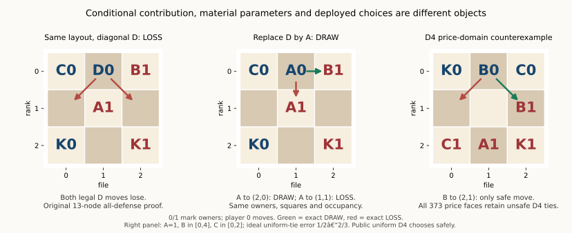

# Legal replacement, conditional value and learning information

The frozen D→A experiment is complete. Of its32 original layouts,12 become
illegal initial positions,19 retain their root WDL,and one changes LOSS→DRAW.
New Knight-like A/B/C components then show18 WDL changes under legal,
same-coordinate composition histories. A single material parameter cannot
minimize the decision error of two selected ABA histories simultaneously.
None of this establishes an intrinsic piece price or a new training gain.

[Selected inputs,results and portable proofs](data/leaper_conditional_value_signal_20261022.json)
are about530KiB. Full graphs,journals and one-off drivers remain local;
the selected file does not purport to contain every full experimental trace.

## Ownership and sources

Execution starts at sidemission
`1f6d110dcd759a8c285f9e64a9e4acc71c8c9af1`,using committed sandbox
`69a3c84ab0be9875611e751e78d3225f0fa8973c` Core,GameSession and public q0
search. The latest fetched mainline has no new shared-package changes.
No rules engine,search backend,product default or PRIMARY state is changed.

Chat1792654941 and1792656600 motivate the distinction between strategy cells,
natural experience exposure and numerical parameter drift. The user's later
scope reminder prompted a read-only check of PRIMARY's committed Main:
its production-generator Static/Unit,opponent and resource work stays with
PRIMARY. This role retains finite Leaper truth,conditional contribution,
material decision regions and learner mechanisms. The twelve-world screen
below is closed;it does not become another general rule-quality campaign.

## D→A at fixed owners,squares,count and occupancy

All32 previously frozen canonical layouts remain in the denominator. Each
replacement first passes the actual compiler and public initial-state API.
Eight rejections attack player0's Anchor and four attack player1's Anchor.
They are failures of this counterfactual's initial admissibility,not draws,
missing games or slots to replace.

| Original WDL | Replacement result | Slots |
|---|---|---:|
| WIN | WIN |6|
| WIN | Initial rejected |8|
| LOSS | LOSS |10|
| LOSS | DRAW |1|
| LOSS | Initial rejected |4|
| DRAW | DRAW |3|

The two admitted-profile graphs complete16964/16956 positions and41567/41552
edges in18.617/18.646 seconds;the whole replacement takes37.688 seconds.
Both original180-second/200k-position graph caps and total600-second allowance
remain unchanged. Seven common-action labels change even where root WDL stays
fixed. No new training or old-sample refill occurs.

At root9615,the old diagonal D has two losing moves. Replacing it with A gives
`(1,0)→(2,0)` DRAW,while `(1,0)→(1,1)` remains LOSS. The original opponent WIN
has a13-node all-defense proof. Two finite nonlosing strategies prove the new
DRAW:399 vertices/677 edges protect player0 and6 vertices/5 edges protect
player1. Every opponent move is included,all graph edges are re-executed by
Core,and permitted cycles terminate as rule-authoritative repeat-two draws.
This argument is specific to the published no-hand,no-aux,capture-removal
Leaper rules;it is not a general history quotient.

Actual selfplay reinforces the distinction between value and decision:
both prices at D1/D2/D4 lose the original D position in four plies.
After replacement,uniform D1 loses in two;uniform D2/D4 and mobility D1/D2/D4
reach actual stalemate in three. These selected mechanisms are not a tournament.

## A price-domain counterexample without a search-value defect

The existing H graph's root127 is the first player0,quiet public initial
position in the saved D4 no-zero-error list;the earlier root114 is checked.
Root127 is DRAW and has one safe action,`B(1,0)→(2,1)`. The other three lose.
Across all373 exact faces of A=1,B∈[0,4],C∈[0,2],the ideal D4 maximizing set
contains a losing action. Uniform-tie expected error is between1/2 and2/3.
This is a declared-domain result,not an impossibility for all coefficients,
deeper search or state-dependent evaluation.

Actual uniform D4 chooses safely. Mobility D4 chooses a proved loss,although
mobility D2,D6 andD8 choose safely. All eight requests complete their declared
depth. Thus neither an unsafe ideal tie nor a larger requested depth alone
determines deployed strength. Two selected bad-action continuations cover
44 actual Core nodes against every defense.

## Larger worlds do not automatically supply learning information

A label-blind factorial fixes two B geometries,three symmetric inventories
and two4×4 layouts before play. Unit/mobility D2/D4 each face fixed FLOOR and
unit D2 in both colors. All192 games finish within their declared caller
budgets in115.976 seconds,with497690 main-search nodes and4549 search calls:
103 actual repetition draws,33 checkmates and56 caller96-ply UNKNOWNs.
The rule clock is512;the56 caller stops are not rule draws.

Changing price leaves78/96 paired full observed records identical;changing
depth leaves30/96 identical. Price normalized-payoff gain remains bounded by
[-0.265625,0.317708],depth by[-0.234375,0.348958]. These are finite missing-value
bounds,not sampling confidence intervals. Identical censored96-ply prefixes
are not canceled as if their future policy outcomes were known.

Seventy-two fixed4/12/24-ply checkpoints from the unit/mobility D2 trajectories
retain terminal clamps and duplicates. Forty-seven are actual terminals.
The other25 slots contain13 different full histories. Existing threshold
reference calls spend100k expansions/depth16 each,1.3million in total and
640.220 seconds including replay,without proving any action WDL there.
All unresolved labels remain UNKNOWN. On these25 histories,the100 completed
D2/D4 public comparisons change no selected action when price changes,
although five critic scores change. This is sparse evidence,not proof that
other histories contain no usable learning signal.

The AAB/ABC exploratory templates move B as well as changing another type;
they are not a clean single-piece replacement. The later Knight construction
below fixes that placement issue rather than rewriting this screen.

## Exact4×4 negative controls

Each side has one King Anchor and one ordinary actor. A common512-coordinate
sample precedes legality and WDL checks;invalid layouts remain recorded.
Ordinary actors are respectively King-like,orthogonal or Knight-like.

| Ordinary geometry | Admitted/rejected | Graph states/edges | Initial W/D/L | Maximum decisive rank |
|---|---:|---:|---:|---:|
| King |125/387|41184/227280|41/84/0|15|
| Orthogonal |202/310|53096/262512|0/202/0|1|
| Knight |217/295|54456/272688|0/217/0|1|

Every material gradient is zero in all148736 graph positions:the only board
unit is fixed and every free hand coordinate is zero. TDLeaf cannot alter
relative ordinary prices in these controls. Yet the King graph has25968
positions with different action WDL. Strategic difficulty and material
learning capacity are different properties.

Orthogonal and Knight have only80/64 decisive states respectively. Every
nonterminal WIN is mate-in-one and every LOSS is terminal. Consequently,
complete full-width D2 with terminal-priority scores distinguishes their
fresh-root WDL bad actions regardless of bounded material leaf values.
Their larger state graphs do not imply a richer price-learning problem.
This statement concerns this exact constructor,not arbitrary played histories.

King D2/D4 make10/4 errors on125 admitted roots;all109 requests actually
completingD8 choose safely. This is root-action quality,not game strength.
King records500 requests,orthogonal808. Four King D12-request receipts have
no usable literal result and remain UNKNOWN. After the complete Knight graph
establishes D2 saturation,its remaining deep-query work is stopped on the
verified owned PID. All249 recorded query rows remain;619 planned queries
remain missing. Exit1 and the scientific stopping reason are preserved.
No stop flag,schedule or other role is changed. D12 requests are reported by
their actual completed depths;most do not completeD12. There is no refill.

## A genuinely new Knight-like composition

The3×3 AB,ABA,ABC worlds keep K/A/B at squares0/1/2 and8/7/6.
ABA/ABC add A/C at3/5. Thus ABA↔ABC holds owners,squares,count,occupancy and
common actors fixed;AB→eight actors explicitly changes density. B now jumps
as a Knight,A is orthogonal,C horizontal. All transitions still use Core.

| World | States/edges | Initial WDL | Genuine-choice prefixes | D2 errors:unit/mobility/H transfer | D4 errors |
|---|---:|---|---:|---|---|
| AB |43160/123536|WIN|25|2/2/3|0/0/0|
| ABA |104597/292101|DRAW|38|8/7/9|6/6/7|
| ABC |133412/385057|DRAW|24|4/2/4|2/2/2|

The edge counts above are checked against the saved graphs. Each world uses64
Core-only random short prefixes selected without labels. Terminal prefixes
(4/5/1) and duplicates remain. All1152 fixed-model receipt slots complete;
1092 nonterminal public choices match an ideal maximizing action within
floating-point tolerance. Terminal receipts have depth0 and are counted
separately,correcting an initial summary that called them fallbacks. No action
query falls back. Old H parameters do not establish cross-geometry learning.

Exact history-aware material-order analysis reuses9/13/373 faces respectively.
Previously visited positions become draw targets in the existing D1–D4
observer;this preserves the actual prefix rather than resetting history.
AB/ABA derive their own one-dimensional breakpoints:the two-A inventory must
not inherit the wrong27-form partition.

For ABA at D4,the best one B constant has3 expected errors on the nonterminal
prefixes;an oracle choosing a separate B per history has5/2. At opening0,
minimum error1/2 requires B≤1;at opening19,minimum error0 requires B>1.
These sets are disjoint over the declared[0,4] domain. This is an ideal
uniform-tie representation diagnostic,not fitted training prices or a claim
that a deployable conditional learner attains the oracle envelope.

All64 ABC coordinate histories are also replayed under the matched ABA rules:
13 DRAW→WIN,5 DRAW→LOSS,42 unchanged and4 rejected replays. Illegal or earlier
terminal paths remain in64. The intervention changes both armies,so these
counts do not estimate one owner's isolated marginal price. Two selected
new-rule wins,following the actual prefixes,have30/25-node all-defense proofs.
The source ABC draw labels remain complete-history observer labels rather
than portable exhaustive draw certificates.

## Validation,cost and next question

The outgoing selected JSON alone verifies five WIN witnesses totaling112
Core nodes,and the405-vertex/682-edge two-player safety proof. All192 screen
records independently replay locally. The146 existing learner/runtime/Leaper
tests pass. An initial check encountered17 TEMP-fixture setup errors;using an
own-checkout temporary directory resolves them without a product change.

Session `d61b4103-9d90-42e1-aa2a-44d76a902305` confirms3865.252329 seconds
(64.42 minutes) of effective research. Configuration,Git/Slack transport and
publication are excluded. All new work is bounded below120 minutes per
experiment. Existing old missing/UNKNOWN slots,caps,models and failures remain
unchanged. Raw sensitive communication and machine receipts remain private.

Next explain the opposite ABA B inequalities through literal leaves/PVs of
histories0/19,then freeze another label-blind experience stream before deciding
whether a new TD run could change a useful decision. Do not add another general
quality/depth panel,fit oracle prices into experiential training,or adopt
PRIMARY's generator/evaluator/default work. Science remains open.
