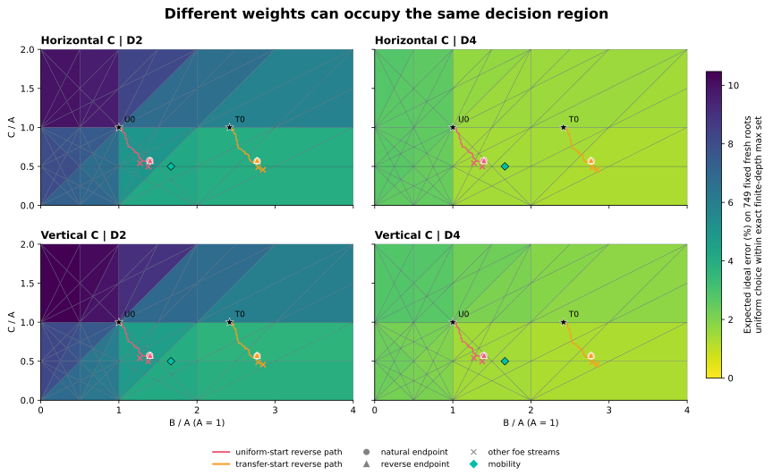

# Opening order, decision regions and the first D benchmark

Reversing the same opening schedule changes the learned numbers slightly, but
does not change either final policy on the measured evaluation. The useful
object is a region of parameters producing the same decisions, rather than a
unique C price. A full reachable-position check also retains a real distinction:
both learned models improve over their own initializations, but only the
transfer-initialized model beats the zero-training mobility comparator under
the declared ideal tie policy. These are finite decision-quality results;
they do not replace actual terminal-game strength evaluation.

[Selected configurations, exact tables and executable witnesses](data/leaper_C_order_regions_D_feasibility_20261022.json)
include all failure and UNKNOWN counts. Full graphs, journals and one-off
drivers remain local and ignored. No learning/search product default changes.

## The order intervention

The already frozen 128 legal opening histories, both colors and two trials are
unchanged. Inside each trial the opening groups run 127 down to 0, retaining
color order 0 then 1. The random opponent stream belongs to the original slot:

`2026102222 + 256*trial + 2*opening_index + color`.

It does not belong to the execution index. This matters: the earlier design
control found 55/117 first opponent choices would change under naive reseeding.
After policies visit different states, equal seeds still do not mean equal
opponent actions. Training reuses the same episode-frozen TDLeaf implementation,
scale10, eta=.05, lambda=.95 and public iterative q0 D2 search. The two arms
retain their original120-second/2M-node limits. No oracle interface reaches
training. The closed natural-order arms are reused, never rerun.

| Initialization | Natural endpoint (B,C) | Reverse endpoint (B,C) | Reverse training |
|---|---|---|---|
| Uniform | (1.394998,.574019) | (1.399360,.577236) | 512 episodes;6 UNKNOWN |
| Prior A/B transfer | (2.770482,.567647) | (2.769010,.579055) | 512 episodes;6 UNKNOWN |

Both reverse arms have zero missing episodes. Every new update reconstructs
exactly from the saved literal PV features and actual outcome:1024 updates,
maximum numerical discrepancy0. All1536 new training/evaluation records,
8114 search/PV receipts and7654 random choices independently replay.

The endpoint evaluation uses the already declared disjoint stream2026110000.
Each arm matches its natural endpoint in all117 ongoing opening decisions and
all256 complete game records. The one censored uniform-arm record remains
UNKNOWN; the independent-censoring gain interval is[-1/256,1/256],while the
transfer-arm interval is[0,0]. Identical censored records are not adjudicated.

During training the uniform arm changes three canonical game records and two
outcomes; the transfer arm changes none of its512 records, despite changed
pre-episode weights. Thus order can affect the adaptive path without changing
the final measured policy. Reversal is one deterministic intervention, not
a claim that every permutation or opponent stream is equivalent.

## What the two-dimensional map establishes

Color is expected error when choosing uniformly from the exact finite-depth
maximizing action set on the previously fixed749 fresh boards. It is not the
deployed lexical tie choice or a game win rate. H-trained paths/endpoints are
placed in both evaluation geometries; no V training is performed. Stars are
the two initializations; the diamond is the empty-board mobility comparator.
The figure colors open regions. Boundaries are evaluated separately below.

With one A/B/C per side, every nonterminal material leaf has coefficients in
`{-1,0,1}^3`. Pairwise equalities of these27 linear forms yield48 nonconstant
lines. Their arrangement in B∈[0,4],C∈[0,2],A=1 contains114 open polygons.
Min/max preserves their weak ordering, so the full-width maximizing action
sets are constant within an open region. This is an algebraic statement;
it does not assume piece values are continuous or uniquely identifiable.

The natural and reverse uniform endpoints both occupy the triangle
`C>1/2, B>1+C/2, B+C<2` (region18). Both transfer endpoints occupy
`1/2<C<1, C+2<B<2C+2` (region34). Therefore their ideal finite-tree action
sets coincide at any fixed depth under the same history and terminal rules.
Actual deployed equivalence is measured here at D2; time cutoffs, different
search policies and different geometry/inventory require their own checks.
The other two foe streams occupy different regions16/17 and31,although their
117-root/256-game evaluation still matches within initialization. A finite
sample can conceal distinctions between genuinely different regions.

All341544 sampled ideal root queries complete. All14592 public D2/D4 checks
at the first32 fixed boards per world return the requested depth and an
action in the corresponding exact maximizing set:0 fallback,0 mismatch.
Fresh D1–D4 observer algebra accounts for the first possible root return at
ply4; it is not a general history quotient or a replacement rules executor.

For completeness,114 polygons,186 edges and73 vertices give373 faces.
Across all60367 H and54038 V ongoing reachable positions, the same observer
completes85346130 root computations in721.102s and639.879s respectively.
Some putative winning actions depend on returning to the root:19300 actions
at10883 H roots and16846 actions at9506 V roots retain [DRAW,WIN] intervals.
They are not assigned invented exact labels. No parameter optimum is claimed
from overlapping uncertainty intervals or outside the declared rectangle.

Paired contrasts share each uncertain root-action label between the two
policies, allowing it to cancel. The following are bounds on the change in
ideal error rate, in percentage points; negative is better.

| Candidate minus comparator | H D2 | H D4 | V D2 | V D4 |
|---|---:|---:|---:|---:|
| Uniform-trained minus uniform | [-2.839,-2.468] | [-1.373,-1.301] | [-2.872,-2.542] | [-1.386,-1.340] |
| Transfer-trained minus transfer | [-.233,-.179] | [-.308,-.278] | [-.254,-.211] | [-.307,-.289] |
| Uniform-trained minus mobility | [.276,.310] | [.120,.124] | [.224,.266] | [.076,.076] |
| Transfer-trained minus mobility | [-.199,-.154] | [-.258,-.204] | [-.204,-.155] | [-.284,-.225] |

These bounds describe the entire declared fresh reachable domains with their
uniform position weighting. They are not sampling confidence intervals, an
actual deterministic tie-policy tournament or independent-rule generalization.
Even allowing every face,2221 H/1942 V D2 roots and645 H/588 V D4 roots have
positive lower expected error. No price within this rectangle makes the
uniform-tie evaluator perfect. This does not prove every deterministic tie
policy must fail at each of those roots.

## A concrete sacrifice and a real depth limitation

At the first previously selected H D8 error,board41934,player0 has K at(2,1)
and C at(2,0);player1 has K at(0,1),A at(0,0),C at(0,2). B is absent.
The safe move C(2,0)→(1,0) draws. K(2,1)→(2,2) loses. An independently
replayed28-node strategy covers all defender replies and ends in three actual
player1 mates. This is a constructed fresh root,not a claimed original-start
game trajectory.

At D8,independent existing Core q0 forced-child searches give safe/bad scores
(-1,-1) at C=0 and(-1-C,-1) for C=.25,.5,.75,1. At C=2 they give(-3,-2).
The represented leaf inventory is A∈{-1,0},C∈{-1,0,1};the checked intervals
cover its nonnegative leaf-order regions. Every positive region prefers the
bad move;the zero boundary permits the public search to select the drawing
sacrifice. This is a useful search-parameter boundary,not proof that C has
zero strategic worth.

Twelve D16/D18 requests under the original2-second,no-reserve policy consume
their allowance before literal PV replay and remain UNKNOWN. A separately
declared four-query control uses the already committed PV-reserve option,
a5-second total allowance and reserves of.1/.25. All four return usable drawing
moves. The D16 requests completeD16;the D18 requests return D17(.1 reserve)
and D16(.25 reserve) fallbacks,not D18.
More budget and a different allocation both changed,so this is not an isolated
speedup estimate or a repair that fills the old twelve slots.

Within a fixed region,the parameter update can still depend smoothly on the
weights. Two saved trajectories,reverse episodes406/407,produce different
updates in opposite orders while every intermediate weight stays in region18.
Halving eta reduces their difference approximately fourfold;the normalized
coefficient approaches.0014585. This is posthoc fixed-path arithmetic,not
another executed training run. It explains why shuffling already evaluated
deltas is an inadequate order experiment.

[TDLeaf](https://arxiv.org/abs/cs/9901001) supplies the search-leaf learning
idea. [Gordon2000](https://papers.neurips.cc/paper_files/paper/2000/file/04df4d434d481c5bb723be1b6df1ee65-Paper.pdf)
studies region convergence under assumptions including linear approximation
and decaying stepsizes. Our fixed-eta,tanh,search-dependent,censored protocol
does not inherit that theorem. Observed chamber crossings are not evidence
of asymptotic chattering or convergence.

## The next genuinely different geometry

H/V local rules are rotations:59851 cached positions and152027 edges match
exactly on their common closed component. Sixty-four actual rotated-history
games,994 moves,preserve the terminal outcomes. But the original initial
layout is not rotated,and the components have68613 versus61189 total
positions. They are orientation/initial-context controls,not independent
movement families. Public lexical tie selection need not rotate.

D is diagonal4,distinct from A orthogonal4,B King8 and C horizontal2.
A symmetric one-Anchor-plus-ABCD army needs ten actors,which cannot fit3×3.
The committed compiler rejects4×3 execution even though its schema exists.
The executable4×4 ABCA/ABCD occupancy-matched pilot completes six D2/D4/D6
queries and eight games;both20k-node/depth12 exact probes remain UNKNOWN,
as do six rollout endpoints. No D learning follows those incomplete probes.

A smaller explicit asymmetric AB-versus-CD world and its army-swapped dual
are exactly solved:10254 positions and24556 edges each. Their default roots
are immediate mate and forced loss in two plies. They are poor training starts.
Among941 six-actor cached boards,525 keep both Anchors quiet and72 also have
no mate-in-one for either player. The first32 by salted board/turn hash are
frozen before deep labels;13 contain genuine action-WDL differences. Unit D2
makes two errors;mobility and frozen H transfer make none. D4 removes both.
These exposed32 contexts already have a strong cheap comparator,so their
existence is not sufficient reason to launch D training.

All32 now run through validated public initial setups. Fourteen retain their
original player0 orientation;18 use an explicit color swap and180° rotation.
The public initial-state API cannot silently set player1. A first attempt to
mix the resulting owner inventories in one setup list is correctly rejected;
two inventory-preserving rulesets repair it within the same120-second clock.
All192 root score controls match the transformed minimax values. Twenty-nine
decisive strategies,259 actual Core nodes,cover all defender replies in the
public setups. Lexical action rotation fails in34/192 cases while the quoted
aggregate error counts stay unchanged;equal optimal scores do not guarantee
equivariant tie choices. No direct state overwrite or alternate rules engine
is introduced.

Next is a frozen,unlaunched D→A replacement control on these same32 layouts,
retaining owner,square,count and occupancy. Rejected/terminal-changed starts
stay visible. Its two180-second/200k-position graph caps and total600-second
budget are in the selected data. The question is conditional composition,
not a universal D price or another training grid.

## Source and verification boundaries

Execution starts from sidemission840d322587b80cc7d1a58acd613c7406f628100b.
The latest fetched sandbox remains69a3c84ab0be9875611e751e78d3225f0fa8973c.
All238 shared source modules match in text;237 working files are byte-identical
and learning/__init__.py differs only in line endings. Core/search/history
infrastructure and all product defaults remain unchanged. This report uses
the current shared library plus DEV_AUX's existing learner/observers.
All146 relevant existing learner/runtime/Leaper tests pass,with0 failures,
errors or skips. The literal record/PV,public-search,all-defense and geometric
controls above provide the scientific checks beyond that test count.

Old cap failures,3848 missing C-direct slots,43 direct UNKNOWNs,the32-history
first-fork limit and prior80/88/65 UNKNOWN plus394 missing observer queries
remain intact. No missing results are filled. Only checked project summaries,
this figure and selected data are published;private Slack originals,local
machine metadata and complete raw journals are excluded. The existing patrols
were changed to ACTIVE60minutes by the user's latest explicit instruction;
their chat targets and the60–90-minute effective research requirement persist.
