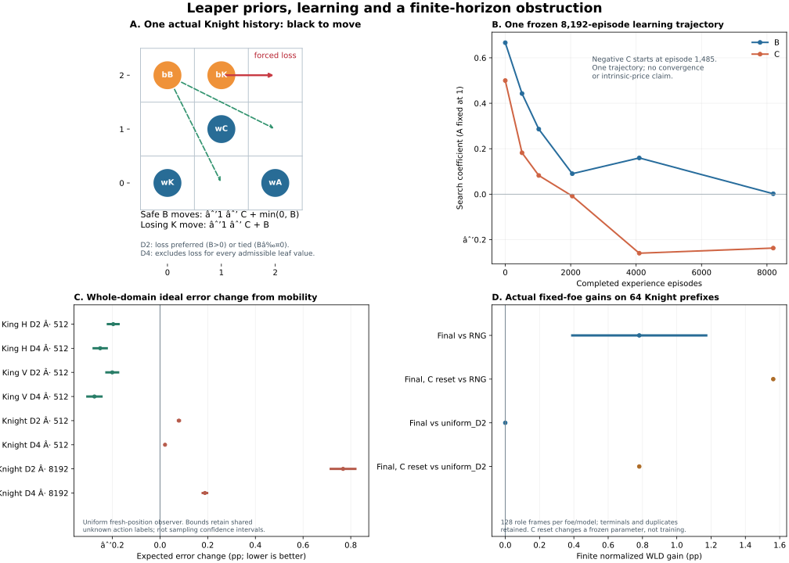

# Leaper priors, finite horizons and signed learning

DEV_AUX / sidemission, 2026-10-22. Fixed mainline infrastructure:
`06894138b79e5a02d485d5170ea6b51c677c6c70`. Its shared package/tests have no
changes from the preceding pinned `69a3c84a` baseline. PRIMARY retains production
generator quality, opponent/resource studies, integration and defaults. This
study concerns finite Leaper references and the existing experiential learner.

Closing synchronization reuses PRIMARY's newly committed
`291f2c3b169992d451743f4babf314ca3a26776f` qualification fix: an actual Core
rule-clock terminal takes precedence over caller censorship. Its ten regressions
pass. It does not change the rules/search used by these frozen Leaper runs;
their executed input/source binding remains the preceding SHA, not a retroactive
claim that they ran the closing revision.

## What changed the conclusion

The missing mobility-initialized TD control **can improve a zero-training prior**
on the old King-like B world. That benefit does not carry over automatically to
Knight-like B. In the Knight world, a 64-prefix diagnostic improves while the
whole fresh-position reference worsens. More experience produces a negative C
coefficient and further reference deterioration, without improving that prefix
diagnostic beyond its early plateau.

A concrete failure explains why price adjustment alone cannot ensure a safe
D2 choice: at one actual history every linear material price vector leaves a
losing action in the ideal best-action set. D4 excludes that action for every
material leaf value allowed by the model. This is a scoped horizon obstruction,
not a search implementation defect or a universal theorem about learning.



Selected numerical evidence, actual histories and portable proofs are in
[the companion JSON](data/leaper_priors_horizons_signed_learning_20261022.json).
Complete raw trajectories, caches and temporary drivers remain ignored locally.
Whole-run replay below is a local verification claim; the selected remote packet
does not purport to contain or independently reproduce every unshipped raw run.

## Same learner, a meaningful prior control

All three new short arms freeze 512 episodes before execution. They use the
unchanged episode-frozen TDLeaf arithmetic: A=1, scale=10, eta=.05, lambda=.95,
public mainline D2/q0, material-independent ordering, 8,192 nodes/query, ordinary
GameSession transitions and a uniform legal RNG foe. Each retains its original
120-second/2,000,000-node cap. All 1,536 episodes complete, with no missing
episodes; 6/6/8 caller-horizon UNKNOWNs remain unknown.

The King B arm adds mobility initialization `(B,C)=(5/3,1/2)` to the existing
H-world opening/foe streams. The two old uniform/transfer arms are reused, not
rerun. The new Knight arms start at `(1,1)` and `(2/3,1/2)`. Mobility is mean
empty-board outdegree relative to A, not an oracle fit or human piece-price prior.

Before Knight training, 64 Core-only walks at seed `2026102206` were frozen
without reference labels. All terminals and duplicates remain: 47 unique paths,
5 terminal prefixes and 27 prefixes with genuinely different action WDLs. Fixed
unit/mobility/H-transfer D2/D4 checks complete all 384 slots. Mobility has 4/1
D2/D4 errors versus unit's 5/4. Its nonzero-gradient/genuine-choice intersections
are 15/21, so this world provides observable experiential signal.

An initial preflight caught the ordinary coexistence placement being illegal
for Knight geometry, before any training call. The existing helper now forwards
an explicit initial position to the existing rule constructor, allowing the
already validated matched Knight placement and actual random-prefix histories.
No rules engine, searcher, default or TD update was replaced. One new regression
checks the explicit board and real prefix history; all 147 related tests pass.

| New short arm | Initial B,C | Final B,C | Paid nodes | Seconds |
|---|---|---|---:|---:|
| King mobility | 1.666667, .5 | 2.058778, .184910 | 32,556 | 24.30 |
| Knight uniform | 1, 1 | .669015, .487867 | 54,026 | 40.79 |
| Knight mobility | .666667, .5 | .437896, .180260 | 54,944 | 41.11 |

These costs describe execution, not a measured acceleration over another
learner. Ordinary concurrent work was allowed. Shared RNG seeds fix a random
stream, not identical moves after candidate policies diverge.

## Prior-plus-learning depends on geometry and measurement distribution

The whole-domain observer resets each cached ongoing Position to fresh history.
It measures the expected error of uniform selection from the **ideal full-depth
argmax set**, not the deployed tie choice or a game win rate. Root-return-dependent
action labels keep their established W/D intervals. The paired calculation uses
one common uncertain action label across candidates, avoiding independent
imputation. None of these intervals is a sampling confidence interval.

| Frozen comparison with mobility | Observer roots | D2 error change, pp | D4 error change, pp |
|---|---:|---:|---:|
| King H, mobility + 512 TD | 60,367 | [-.219,-.174] | [-.278,-.224] |
| King V, same frozen H-trained model | 54,038 | [-.225,-.176] | [-.305,-.246] |
| Knight, same-run checkpoint 512 | 125,361 | [+.075,+.083] | +.021 |
| Knight, checkpoint 8,192 | 125,361 | [+.716,+.819] | [+.179,+.197] |

Lower error is better. H/V are related constructed geometries, not independent
rule-family samples. The Knight checkpoint-512 row belongs to the new duration
trajectory described below; it is not silently substituted for the other short
seed. Its deterioration by checkpoint 8,192 is also bounded directly:
D2 `[+.641,+.736]` pp and D4 `[+.158,+.176]` pp.

Actual short evaluation preserves all 2,688 games and 1,024 root-query receipts.
The 128 King prefixes contain 117 ongoing histories; the 64 Knight prefixes
contain 59. Terminals and repeated paths remain in every planned denominator.
No returned action falls back below its requested depth.

For fixed-foe pairs below, gain is mean `(candidate WLD - prior WLD)/2`, where
W/L/D is +1/-1/0. Each uncompleted outcome independently contributes its full
[-1,1] range. Identical capped prefixes do not justify cancelling the unknown
future of different policies.

| Short candidate minus prior | Foe | Role frames | Finite gain bounds |
|---|---|---:|---:|
| King mobility TD - mobility | RNG | 256 | [-3/256,5/256] |
| King mobility TD - mobility | uniform D2 | 256 | 1/128 |
| Knight uniform TD - uniform | RNG | 128 | [1/64,3/128] |
| Knight uniform TD - uniform | uniform D2 | 128 | -1/128 |
| Knight mobility TD - mobility | RNG | 128 | 5/256 |
| Knight mobility TD - mobility | uniform D2 | 128 | 0 |

Separate direct-play estimands retain both colors: King mobility TD versus its
prior scores 89W/85L/82D, mean WLD 1/64. Knight uniform TD versus uniform scores
9W/11L/108D; Knight mobility TD versus mobility scores 11W/11L/106D. Direct-play
mean WLD and the normalized fixed-foe contrast are different quantities.

Thus the added King control rejects the claim that this learner can *only*
repair a poor uniform initializer. It does not establish that learning always
improves a mobility prior. The Knight results also show why a small natural-prefix
panel, a uniform fresh-position observer and opponent-specific utility can
disagree without any result being silently discarded.

## A losing policy path and an all-price D2 obstruction

The two additional Knight uniform-TD losses against fixed uniform D2 are slots
14 and 62: the complete paths are duplicates, not two independent mechanisms.
Their first divergence at ply3 preserves exact DRAW for both actions. The learned
path subsequently blunders at ply5; the uniform path never enters that state.
At the blunder history, uniform, mobility and both learned snapshots all choose
the loss at D2, while all four D4 controls choose a nonlosing action.

The actual black-to-move board is shown in panel A. Coordinates are zero-based.
Black B at `(0,2)` can move to `(1,0)` or `(2,1)`, each an exact-observer DRAW.
Moving black K from `(1,2)` to `(2,2)` instead permits White's forced mate.
A six-node all-defense Core certificate proves the win after that losing move.

An independent Core-only D2 tree contains 17 nodes. In black's perspective the
opponent-response leaf coefficient lists give the exact action scores

```
each safe B move:  -1 - C + min(0,B)
losing K move:     -1 - C + B
```

Every leaf has A coefficient -1 and C coefficient -1. The safe branches contain
both B coefficients 0 and 1; the losing branch contains only coefficient 1.
Consequently **for every real B and C in the admissible material range**, B>0
strictly prefers the loss, while B<=0 ties all three actions. No price vector
makes the ideal D2 argmax set entirely safe. At B<=0 its uniform-tie error is 1/3.

The initially considered negative-B strict reversal is false: the opponent
switches responses when B changes sign. The corrected formula and original
diagnostic failures are retained. Actual public B=-1/0 controls choose a safe
tied action; that is a deployed tie-policy effect, not a strictly safe ideal set.
The final learned positive B still chooses the loss.

A separate 169-node Core D4 interval tree allows every nonterminal material leaf
to range over [-500,000,500,000], conservatively enclosing Model's safety range.
The losing action's value is exactly -999,999,996; both safe actions have bounds
[-500,000,0]. Thus complete D4 excludes the losing action independently of these
material prices. Eight literal signed-price D2/D4 calls confirm the stated
deployment behavior. Source DRAW labels rely on the complete graph observer;
the portable positive-WIN certificate is a separate, directly replayable claim.

The earlier ABA0/19 question is also closed: their opposed ideal B regions arise
from competing constant, B and min/max(B,1) leaves. Independent complete Core D4
trees verify all 13 one-dimensional faces in 518 visits. Yet the four requested
public queries do not change actions. Opposed ideal minimizing regions alone
do not establish a deployed policy contradiction.

## More experience and a frozen B/C intervention

A **new**, independently frozen trajectory starts from the Knight mobility
prior, uses 128 label-blind walks at seed `2026102211`, and keeps the same learner
and RNG foe. Its declared budget is 8,192 episodes, 900 seconds and 4,000,000
nodes. It completes in 566.52 seconds, paying 724,135 nodes and 59,326 searches;
119 caller-horizon UNKNOWN episodes remain. This is not a refill or continuation
of any closed short-run cap.

| Completed episodes | B | C | D2/D4 errors on the frozen 64 prefixes |
|---:|---:|---:|---:|
| 0 | .666667 | .500000 | 4 / 1 |
| 512 | .442788 | .182167 | 1 / 1 |
| 1,024 | .286298 | .082356 | 1 / 1 |
| 2,048 | .090231 | -.008229 | 1 / 1 |
| 4,096 | .159550 | -.259643 | 1 / 1 |
| 8,192 | .002001 | -.237050 | 1 / 1 |

The companion JSON is authoritative for full-precision checkpoints. C first
becomes negative after episode1,485 and is negative at 6,664 updates; B stays
positive throughout. Its minimum is the final .00200087; minimum C is -.369196.
The trajectory crosses material comparison regions 86 times. These observations
are not a convergence or formal policy-chattering result.

Before the producer finishes, assessment freezes a final-coordinate factorial:
final, B reset to 2/3, C reset to 1/2, and the original prior. This changes frozen
parameters, **not** the training process. It completes 1,152 role frames: 896 new
physical games and 256 exact previous baseline reuses. All 1,280 root receipts
complete; initial-equivalent receipts are explicitly reused.

| Frozen final intervention minus prior | RNG, 128 frames | Uniform D2, 128 frames |
|---|---:|---:|
| Full final | [1/256,3/256] | 0 |
| Only B changed; C reset | 1/64 | 1/128 |
| Only C changed; B reset | [1/128,1/64] | 0 |
| B-by-C interaction | [-7/256,-3/256] | -1/128 |

Final-versus-prior direct play is 13W/11L/104D, mean WLD 1/64. Resetting C gives
better fixed-foe results here even though the 64-prefix error count is unchanged.
The whole-domain reference, meanwhile, worsens even for the B-only intervention:
D2 `[+.181,+.241]` pp and D4 `[+.032,+.098]` pp. These are opponent/distribution
and parameter-interaction findings, not intrinsic negative C or a retraining
ablation. No extra training is queued on the strength of numerical drift.

## Signals, history and scope of theory

For each resolved frozen episode, the existing update satisfies the exact identity

```
sum[k=j..T-1] lambda^(k-j) delta[k]
 = (G-v[j]) + (1-lambda) sum[k=j+1..T-1] lambda^(k-j-1) (v[k]-G).
```

Multiplying the original PV gradient and eta, then summing origins, separates
the actual-return direction from the bootstrap-minus-return correction. It does
not execute a Monte Carlo learner or choose a new lambda. Censored episodes
have no final G and remain in a separate interior-TD total.

For the short Knight mobility arm, resolved actual-return C direction is
-.413338 while the bootstrap-minus-return correction is +.103323. The correction
partly opposes the C decrease; it does not explain it away as a purely invented
bootstrap reward. Frozen-path directions are not predictions of another
on-policy training run or causal reward allocations.

A separate observer freezes 512 actual-history contexts per geometry before
labelling. All 1,024 complete, out of 1,826 King/3,317 Knight distinct observed
contexts. Among 64 preselected same-Position/different-visited-set pairs per
geometry, two King pairs change best WDL and three change action labels; no
Knight pair changes either in this sample. The selected contexts include winning
episode actions with suboptimal reference WDL, and losing-episode actions that
are reference-optimal. Query occurrences, duplicate paths and already-lost
positions are not independent games or interchangeable notions of success.

The search still uses complete GameSession history. Position-only or material
features are approximations, not sufficient exact WDL labels. No observer label
enters experiential training, and no history is reset to fill a game result.

[Baxter, Tridgell and Weaver's TDLeaf paper](https://arxiv.org/abs/cs/9901001)
motivates learning through searched leaf values and discusses initialization,
exploration and changing training distributions. Its positive chess experiment
is not evidence for these Leaper outcomes. [Gordon's region-convergence paper](https://papers.neurips.cc/paper_files/paper/2000/hash/04df4d434d481c5bb723be1b6df1ee65-Abstract.html)
has linear-function and learning-rate assumptions; our tanh transformation,
fixed step size and searched target process are not covered by that theorem.
Finite boundary crossings therefore do not establish its formal phenomenon.

## Verification, caps and next decision

All 147 related tests pass. All new short training records, RNG streams,
literal PVs and TD updates replay independently; maximum update reconstruction
error is at most 1.12e-16. The duration replay checks 8,192 episodes, 118,305
actual moves and 114,729 PV moves, with maximum update error 5.56e-17. The first
evaluation checks 35,400 actual and 58,552 PV moves. Duration assessment checks
19,215 actual and 33,736 PV moves, including explicitly identified reuses.
The selected WIN witnesses replay 52 nodes, with duplicate King witnesses
identified by their actual prefixes; they are not 52 independent examples.

The positive-domain Knight scan stops at its original 1,200-second cap with
221 complete faces and one additional D2 row of 373 faces. Its 55,534,923
recorded complete root-depth slots do not include all paid in-flight work.
After negative C is observed, a separately frozen signed-domain study considers
only B<0 or C<0 faces of [-1,1]^2. It never computes missing nonnegative slots.
It stops at 1,200 seconds with 223 complete faces plus one additional D2 row
of 494 faces, retaining 56,036,367 complete root-depth slots. Its final
cap/coverage receipt is retained in the companion packet. Neither
partial scan establishes an all-boundary optimum. The reported paired endpoint
contrasts use faces that actually completed, not the uncomputed remainder.

The next bounded research question is composition-conditioned transfer: reuse
the old 64 matched ABC-to-ABA paths, including all four legal-replay rejections,
and compare these already frozen B coefficients at D2/D4. This can distinguish
a geometry-only transfer claim from dependence on the added C/A actor without
new graphs, training, a general quality campaign or PRIMARY work. An alternative
is making one observed King history-alias pair portable, explicitly retaining
the difference between a WIN witness and a full DRAW certificate.
