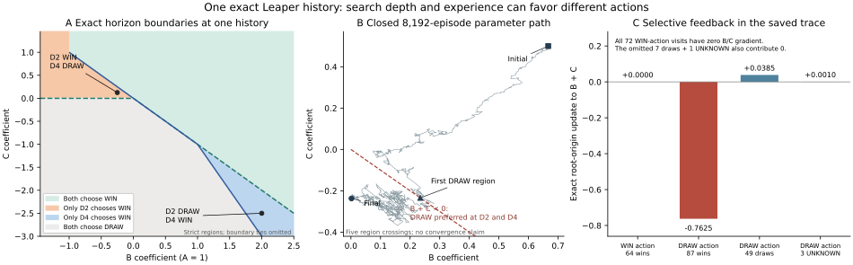

# Composition transfer and selective terminal feedback

A real training victory can reinforce a minimax-worse action. In one fully
specified Leaper history, the old learner chose a theoretically drawn move139
times, still won87 of those games against its random opponent, and those87
victories pushed the material parameters further toward that drawn choice.
Choosing the available forced win supplies no B/C gradient at that query.
This is a mechanism in a saved trajectory, not a new training result or a
claim that terminal rewards are intrinsically uninformative.

[Selected rules,records,Core trees and witnesses](data/leaper_transfer_terminal_feedback_20261022.json)
are approximately606KiB in the published Git blob. Full raw trajectories,graph caches and one-off
drivers remain local rather than adding generated archives or scripts to Git.

## Sources and scope

Research begins from sidemission
`f03511403e409360abc7835e985d5d8e94a78069`, using sandbox infrastructure
`291f2c3b169992d451743f4babf314ca3a26776f`. The initial fetch finds no newer
published mainline. Core, GameSession, public q0 search and the learner are
unchanged. PRIMARY retains production-generator quality, opponent/resource
campaigns, integration and defaults. These are finite Leaper truth,
composition and learning-mechanism studies.

Before the final census,mainline advances to
`55abf3de22f20ac03eb07b5260284466173a3264`. Its shared package and tests are
identical to291f2c3;its new inactive-feature/default-coefficient clarification
is reused in this checkout's protocol. No PRIMARY research queue is imported.
The earlier computations retain their actually executed291f2c3 source.

The prior512/8192-episode runs, both1200-second parameter scans and all older
caps remain closed. New analysis reads saved records; no games, training,
graph generation, workers or timers are added. The periodic cadence stays60
minutes. Chat/Claude1792665553/1792666124/1792666250 are read and reviewed:
adopt depth-conditioned exposure and real-WDL distinctions; do not import
PRIMARY tasks or rerun the frozen ladder to remove its UNKNOWN endpoints.

## Matched short-prefix transfer

The original64 ABC coordinate histories remain fixed. Replacing both C actors
with A holds owners, squares, count, occupancy and the remaining actors fixed;
it can change legal moves, checks, terminal events and repetition identities.
The four previously rejected counterfactual replays remain in the manifest.

Prior, uniform-initialized short TD, mobility-initialized short TD and the
long mobility TD endpoint are frozen before this comparison. ABC retains
each endpoint's C; ABA removes C without shifting its weight into a hand
channel. Both worlds use the same actual full prefix at D2/D4.

The180-second cap stops at180.584 seconds:858 of992 admissible receipt slots
are durable,134 remain missing;32 other model/depth slots correspond to the
four original replay rejections. Of the858 receipts,16 are actual terminals
and842 complete their requested depth. The partial last prefix remains
partial. Nothing is refilled.

| Contrast against prior | Paired ongoing slots / distinct paths | D2 action changes / WDL changes | D4 action changes / WDL changes |
|---|---:|---:|---:|
| ABC uniform-short |54 /39|0 /0|0 /0|
| ABC mobility-short |54 /39|6 /0|3 /0|
| ABC mobility-long |54 /39|16 /1 worse|19 /1 worse|
| ABA each learned B |51 /36|0 /0|0 /0|

These are complete-pair contrasts, not mismatched totals or game win rates.
The source's short-model action changes need not have strategic consequences.
The long endpoint's one worsened history is a lost forced win, not a forced
loss: its chosen action is DRAW instead of WIN.

The ABA inventory gives a useful exact limitation. Its material vectors lie
inside A∈[-2,2],B∈[-1,1]. The sufficient leaf-order breakpoints on B∈[0,4]
are0,1/2,1,3/2,2,3,4. Prior B=.666667 and uniform-short B=.669015 are in
the same strict chamber; mobility-short B=.437896 and long B=.002001 are
in another common chamber. Inside each chamber, induction through min/max
preserves every ideal full-width finite-depth maximizing set at the same
history, with the same price-independent terminals. This is sufficient
policy equivalence within a chamber, not proof that all B values or public
tie choices are identical.

## A target-domain transfer that matching excludes

Zero changes in the matched target histories do not make B irrelevant in ABA.
A separate13.432-second cached check covers all94902 ongoing fresh ABA
Positions. Comparing the two strict B chambers changes1542 D2 maximizing
sets and1326 D4 sets; including B=1/2 adds16 boundary-only D4 changes.
These are fresh-position policy differences, not natural visits or WDL gains.

The first four support-changing vertices per depth are selected before
reading their WDL and then reached through existing legal Core BFS histories.
All eight public prior/final comparisons change action. Seven preserve action
WDL; at D4 vertex80, the transferred low B improves LOSS to DRAW. An eight-node
all-defense opponent WIN witness verifies the prior action's loss. The DRAW
side retains the complete-history observer label.

That target history is only three moves:

1. White B(2,0)→(1,2).
2. Black's added A(2,1)→(2,0).
3. White A(1,0)→(2,0).

The second move is illegal in ABC: that actor is a horizontal C. Thus this
genuine target opportunity cannot appear in an ABC-compatible coordinate
history. The source-derived matched population excludes a real form of
positive transfer. This selected example is not a target-wide gain estimate;
it motivates checking target-native experience before declaring the material
channel unimportant or launching more unchanged source training.

## An exact parameter-by-horizon interaction

At the selected three-ply ABC prefix, Black has three legal actions:

| Action | Exact action WDL | D2 score, Black perspective | D4 score |
|---|---:|---|---|
| A(1,2)→(1,1) |WIN|1|max(1,B)|
| B(0,2)→(2,1) |DRAW|1−C−max(B,0)|−B+max(0,1−C)|
| B(0,2)→(1,0) |LOSS|−999999998|−999999998|

The151-node literal Core D2/D4 trees reproduce every branch score. Exact
min/max distributivity and absorption give the displayed formulas; decisive
terminal scores dominate the admitted material leaves. No sampled price grid
is used to infer these identities. The winning root also has a portable
all-defense WIN witness; DRAW action labels retain their complete-graph
observer provenance.

D2 prefers the win exactly when C+max(B,0)>0, with a WIN/DRAW tie at equality.
D4 prefers it exactly when B+max(1,B)>max(0,1−C). At the actual positive
B≤1 endpoints, both depths have the same winning boundary B+C=0. The final
B=.0020008676,C=−.2370495014 is on the drawn side. Resetting either B or C
alone to its prior keeps the ideal winning action at both depths; changing
both crosses the boundary. These are frozen parameter interventions, not
retraining ablations or intrinsic piece interactions.

The two boundaries are not globally identical. Two strict diagnostic controls
complete all four public searches:

| B,C | D2 action WDL | D4 action WDL |
|---|---|---|
|−1/4,1/8|WIN|DRAW|
|2,−5/2|DRAW|WIN|

Thus greater depth can repair or introduce this particular WDL error under
different material parameters. These two algebraically selected controls are
not training inputs, a held-out test or a universal depth-performance claim.

## What the actual victories taught

All8192 saved episode endpoints are evaluated against the exact fixed-probe
boundary, without executing another search. B remains between.002001 and
.667528. The first drawn policy occurs after episode2660; the trajectory
crosses this decision boundary five times. There are2899 winning-region and
5293 drawn-region endpoints. These counts do not establish convergence,
chattering or independent observations.

More directly, the exact same complete prefix is actually queried in211
training episodes. This is not a Position-only match:

| Executed action class | Candidate wins | Actual draws | UNKNOWN | Nonzero B/C gradient at this origin |
|---|---:|---:|---:|---:|
| Exact WIN |64|7|1|0 /72|
| Exact DRAW |87|49|3|139 /139|

The winning action's nonterminal PV has only the fixed A imbalance. Its B/C
gradient is zero, even in the64 games that actually win. The drawn action
exposes free B/C features. Replaying every selected episode's original TD
updates agrees with saved endpoint weights within2.78e−17.

At that one query origin, the87 wins following a DRAW action contribute
−.7625390644 to B+C. Its frozen actual-return component is the entire value;
the bootstrap-minus-return correction is exactly zero. The49 actual draws
contribute+.0385031391, including an actual-return direction+.0550688831
and bootstrap correction−.0165657440. The three censored episodes contribute
+.0009759946 of TD terms and have no actual-return decomposition.

This is an exact sum of update terms on the executed trajectory. The
actual-return decomposition is not an executed Monte Carlo learner, and
changing those updates would change later behavior and data. Conditional
win rates here are endogenous, not randomized comparisons of the actions.

Episode2929 supplies a small portable example. After the learner takes the
DRAW action, the random defender chooses a proved losing reply despite an
available DRAW reply. The actual game ends in Black's checkmate victory at
ply6; a two-node all-defense certificate verifies the resulting win. Public
unit-price D2 and D4 defender searches both choose a DRAW reply. This one
example is not an opponent-strength campaign or new paired-game estimate.

A frozen one-query bound makes the mismatch explicit. The random defender
has exactly three legal replies;two allow Black mate in one,and both fixed
final-model D2 calls take that mate. Even allowing the third branch any full
rule payoff in[-1,1],Black's expected payoff is at least1/3. At the final
probe parameters,the actual-return B+C gradient is therefore at most
−.0020727486. This does not impute caller UNKNOWNs,execute a Monte Carlo
learner,predict the expected TD(lambda) update,or show that this DRAW action
outperforms the available WIN action against RNG. It is a frozen one-query
sensitivity bound under an explicitly uniform next reply.

The observed feedback can therefore reinforce a minimax-worse choice without
requiring a bootstrap error: victories against a fallible opponent are real
outcomes, while their implications for a free material coordinate depend on
the selected PV and gradient. Fixed-RNG return and perfect-defense WDL remain
different objectives. No oracle labels enter experiential training.

## Two limits on state and composition claims

The two earlier King-history pairs have identical Positions but different
observer WDL. New24-node and14-node all-defense WIN witnesses establish their
positive sides through actual Core. Both pairs nevertheless have nonempty
intersections of optimal actions. They demonstrate that Position alone is
insufficient for exact WDL, not that these two examples force incompatible
optimal policies. Their DRAW sides are not presented as portable full-DRAW
certificates.

The older all-price D2 obstruction also changes under legal C→A replacement.
Its ABC history is DRAW with two safe moves and one loss. Replaying the same
coordinates under ABA leaves exactly one legal action and a forced LOSS,
verified by a seven-node WIN witness for the opponent. The old safe-versus-loss
price inequality no longer describes that counterfactual: there is no safe
action to select. A deeper search's recognition of the loss does not create
an improvement opportunity in a lost root.

## Validation and retained failures

The69 focused Leaper and mainline qualification-boundary tests pass. The
selected literal Core trees, positive certificates and actual episode can
be checked from published rules/prefixes without private graph caches. Full
trajectories, graph caches and one-off drivers remain local. The211-episode
census and broader natural-history aggregates are locally checked results,
not claims of remote replay of unshipped raw records.

The first parameter-intervention script incorrectly requested a WIN
certificate from the DRAW child. Its four intervention searches had executed
but were not durably saved before that error; those receipts remain unavailable
and are not rerun. Recovery derives ideal intervention sets and reuses the
already saved prior/final receipts only. A separate formula-check assumption
that all D2 replies were nonterminal was corrected using the actual terminal
leaves; the failed assertion and first source remain local.

## Broader saved natural histories

A separately frozen post-hoc run hashes the30443 different complete candidate
query prefixes from the closed8192-episode trajectory, retains all59326
occurrences, and selects4096 prefixes before any new query or label. The
selected prefixes represent7192 original visits. This is an endogenous,
exposed on-policy corpus, not a held-out sample or independent rule family.

The original2700-second budget stops at2700.001 seconds. There are3698 durable
complete-prefix rows and398 missing. The producer pays for25631 searches;
25628 receipts are durable and three calls in the partial final prefix are
unavailable. No call or prefix is rerun to repair the difference.

The3698 source prefixes represent6462 original visits,1315 Positions and3698
distinct restricted (Position,visited-set) observer contexts. Target ABA
retains860 complete replays:852 ongoing and eight actual endpoint terminals
(seven stalemates and one checkmate). Another2291 prefixes contain an illegal
target move;547 encounter an earlier target terminal (313 checkmates and234
stalemates). Rejected complete-prefix counterfactuals are not zero-valued
target observations, missing games or automatic draws.

| Completed population and contrast | D2 action changes / WDL better / WDL worse | D4 action changes / WDL better / WDL worse |
|---|---:|---:|
| All3698 ABC contexts, final−prior |670 /0 /2|742 /0 /1|
| All3698 ABC contexts, B-only−prior |204 /0 /0|206 /0 /0|
|852 both-ongoing contexts, ABA final B−prior |0 /0 /0|1 /0 /0|

The source deterioration counts carry visit weights6 at D2 and3 at D4.
The852 common ongoing histories represent2578 original visits. Eighteen
change source DRAW to target WIN and nine change DRAW to LOSS;825 retain
their root WDL. The B-only intervention has zero observed WDL effect in
both worlds on that completed common subset. This isolates a parameter-by-
composition comparison without conflating the source's learned C change.

All completed public choices lie in the corresponding ideal rational
maximizing sets. This does not make ideal randomized ties the actual deployed
tie policy. Root-action quality is also not whole-game strength.

The398 missing source pairs remain decision-relevant uncertainty. For the
whole4096-prefix source panel, final-minus-prior mean binary error completion
bounds are[-99/1024,25/256] at D2 and[-397/4096,399/4096] at D4. These finite
missing-value bounds cross zero; they are not sampling confidence intervals.
No target-wide average is manufactured for counterfactual histories that
do not exist. Observed zero target gains apply to the completed admissible
source-derived subset, while the vertex80 example proves a useful target
opportunity outside that support.

## Exact quality behind fresh-position sensitivity

A final600-second allocation first annotates only the changed maximizing
sets in the complete fresh ABA graph. Unchanged sets cancel exactly without
imputing any uncertain action label. Both fresh-depth annotations complete:

| Depth | Changed sets | Roots with lower ideal error | Higher error | Unchanged error |
|---|---:|---:|---:|---:|
|D2|1542|64|244|1234|
|D4|1326|64|104|1158|

The frozen low-B chamber raises whole-domain mean ideal uniform-tie error by
250/142353 at D2 (about.176 percentage points) and8/142353 at D4 (about.00562
percentage points). These are exact finite fresh-position averages for two
fixed chambers, not fitted optima, natural visitation frequencies or actual
public-search win rates. A selected LOSS→DRAW transfer coexists with losses
elsewhere. Only a minority of price-induced action-set changes alter WDL
quality.

The same allocation then replays one legal pre-existing Core BFS history for
each of the2424 vertices sensitive at either fresh depth. It stops at600.221
seconds with1476 completed histories and948 missing. Fifty-six fresh WIN
labels become actual-history DRAW,and seven fresh LOSS labels become DRAW.
The other1413 root labels stay fixed. Every completed root/action label
passes the scoped draw-truncation consistency check;no UNKNOWN is filled.

Among those1476 completed histories,low B lowers ideal D2 error at19 roots
and raises it at83;D4 has16 improvements and24 deteriorations with a net
error difference of zero. The full2424-history D4 completion bounds remain
[-79/202,79/202],so the partial zero sum is not a target-wide equivalence
claim. These histories are a policy-selected mechanism population,not all
histories or a natural frequency sample. Fresh values are never silently
substituted for complete-history values,and the948 missing histories are
not resumed or topped up.

## Delivery and next useful question

The selected packet alone verifies six positive WIN witnesses totaling71
Core nodes,the151-node horizon trees,and episode2929's actual game,PV leaves
and original update. All69 focused tests pass. The broader local aggregates
are deliberately distinguished from that selected independent replay scope.
Only this report,one figure,selected data,own mainline/collaboration records
and the reused protocol clarification are published. Shared engine code is
unchanged in this research segment.

Session06f2aaa8-b84e-48c7-99d8-09f1563aa562 confirms3799.576597 seconds
(63.33 minutes) of effective research before delivery. Configuration and
publication are excluded. Both bounded producers exit0 with capped missing
work intact;no stop or cadence is changed. The old uncertain Slack report is
not resent,and no external reading/adoption is claimed.

Next reuse the already frozen target-native ABA64-prefix population to
separate native experience exposure from the ABC-compatible subset,before
considering more training. Keep all original duplicates/terminals and frozen
models;do not select learning starts using these oracle-labelled examples,
refill the two closed studies,or adopt PRIMARY's production campaigns.
