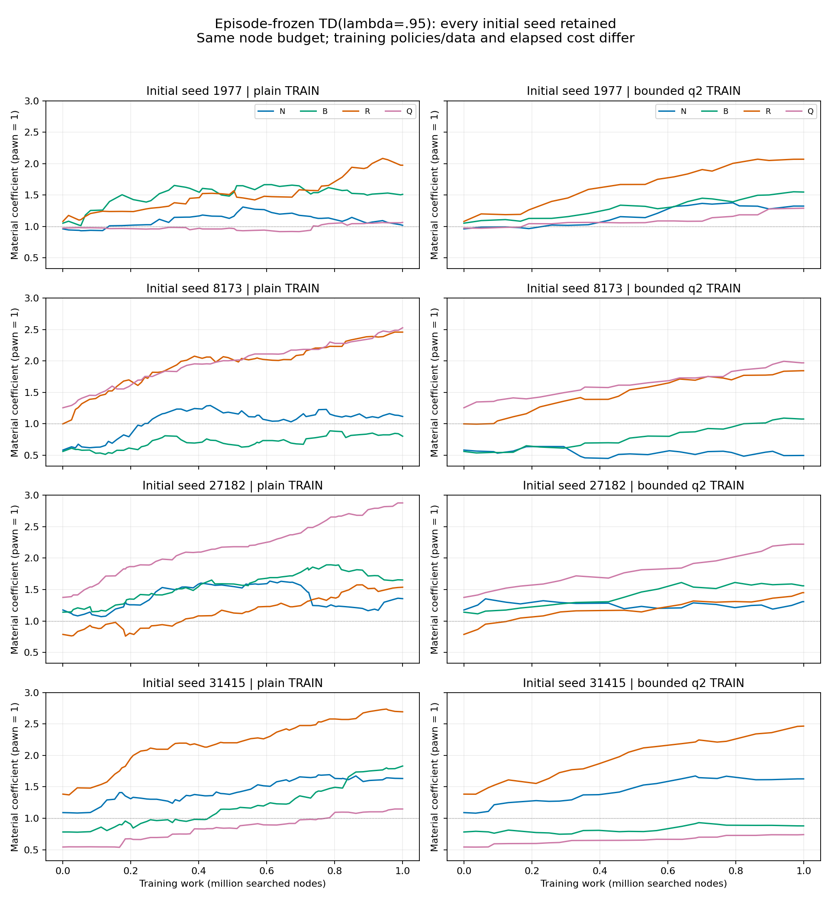
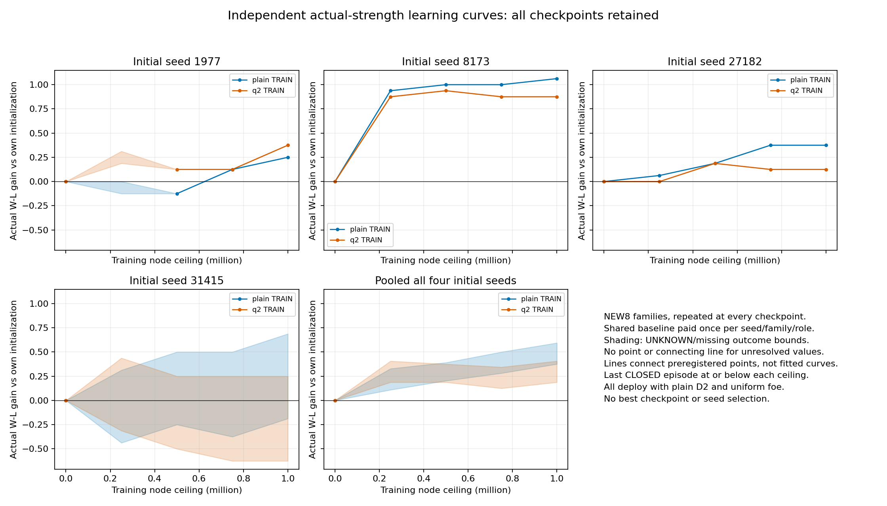
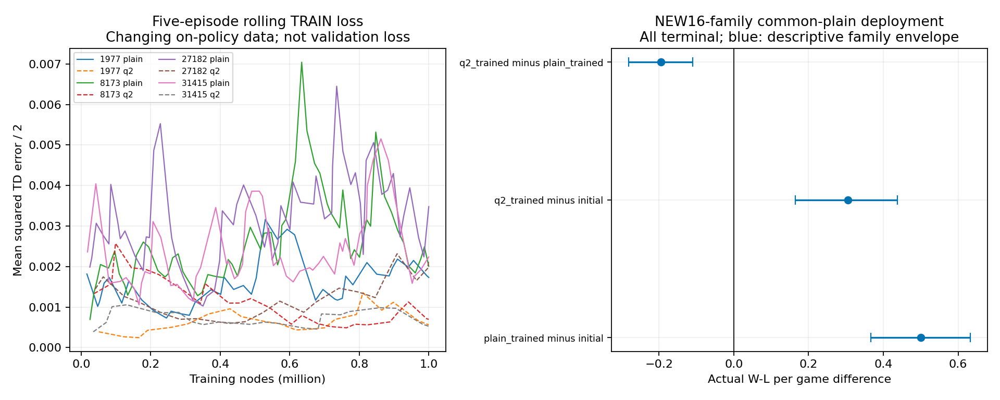

# Segment87 — TD training regime and actual-strength curves

The NEW16-family endpoint is a scoped positive TD-learning result: allfour
initializations improve against the frozen uniform opponent. Plain training gains
.5000W-L/game; boundedq2 gains.3046875; q2-minus-plain=-.1953125, lower for
everyinitialization. This supports incremental learning here, not q2superiority.
It does NOT establish stable material ordering: final Q/N rankings still differ
across initials. The additional preregistered8-family curves below test the work
trajectory without choosing a winner or checkpoint.

The direct USER route reset remains in force: incremental TD/search bootstraps
train material weights; actual rules W/L/D evaluates strength. The generic WIN
Prover, old finite WDL grids and full quiescence completion are not prerequisites.
Bothplayers use the predeclared policy of claiming any available legal
threefold/50-move draw, including a permitted claim by intended next move.
Full move history is retained; rule draws differ from budget/horizon UNKNOWN.
All changes are opt-in research files in DEV_AUX/sidemission, with no PRIMARY,
product/default/UI edits. Scientific status remains OPEN.

This study asks ONE next question after86: does an explicitly bounded tactical
training search improve the SAME episode-TD learner at a common node budget?
It compares complete training regimes under COMMONplainD2 deployment, not pure
target quality or deployed q-enabled players. See [method alignment](METHOD_20261017_87.md).

Four random initializations, pawn1 and all other coefficients independently
uniform[.5,1.5]; no human price ordering, SEE, material move ordering, nullmove,
futility or positional/external evaluation. Shared path-seeded random ordering
is coefficient-independent and unaffected by extra qcalls. Each episode freezes
weights; TDLeaf(lambda=.95,eta=.05) updates all non-pawn coefficients after the
sequence. Tanh(material/10) is an arbitrary fixed learning transform, not a
calibrated win probability. All seeds/conditions retained; no best checkpoint.

Full capture/evasion qsearch2502 closed at its ORIGINAL240s: quiet4/64 roots
complete at8192nodes,2/40 returned at32768 with24 missing. No fullq training2503
started. A separate q2 approximation counts NONCHECK static cutoffs even when
captures remain; ALL check evasions continue. Resource exhaustion discards the
whole query. The qply counter counts ALLextensionedges, including forced
evasions; a noncheck node at qply>=2 may cut. Earlier source/request prose
"two optional plies" was imprecise; after forced evasions fewer optional
captures can occur. Frozen code/plans/data/caps are unchanged; exact semantic
clarification is task2508/q2-semantic-scope.json. This is not full-quiet or exact WDL. Its TRAIN-only feasibility
pilot completed all128pairedqueries/71996nodes/10.62s. Original failures and the
inherited scope wording error are preserved and corrected separately.

## Training and credit

All8arms CLOSED: 8000000nodes, 1117.59s, 317episodes (304actualterminal/13censored), 48004TDterms. Same NODE budget, different elapsedcost and learning opportunities.

|Seed|TRAIN search|Queries|Games W/L/D/U|Seconds|Final P/N/B/R/Q|
|---|---|---:|---|---:|---|
|1977|plain|9623|10/13/17/5|144.36|1.0000/1.0176/1.5104/1.9741/1.0639|
|1977|q2|4241|10/7/3/1|145.12|1.0000/1.3233/1.5471/2.0694/1.2892|
|8173|q2|3866|13/7/4/1|143.37|1.0000/0.4944/1.0746/1.8430/1.9683|
|8173|plain|7802|26/22/13/1|134.89|1.0000/1.1152/0.8007/2.4573/2.5264|
|27182|plain|7106|32/19/11/1|131.72|1.0000/1.3552/1.6528/1.5372/2.8787|
|27182|q2|3197|8/11/1/1|142.56|1.0000/1.3073/1.5597/1.4507/2.2219|
|31415|q2|4087|6/13/3/1|142.58|1.0000/1.6268/0.8784/2.4665/0.7398|
|31415|plain|8103|21/17/17/2|132.99|1.0000/1.6327/1.8311/2.6943/1.1472|

These training W/L totals use white orientation in selfplay, NOT candidate
strength. All failed query nodes count. Censored games retain prior bootstrap
updates and omit the unknown terminal delta; no U becomes a draw. Five games
reach H512, and eight stop at their final1Mnode pool: failed queries use only
the remaining2–509nodes, not a full8192node-query failure. No pool is extended.

All317episode updates independently reconstruct by a forward lambda-return sum
of saved PV gradients; production uses vector eligibility. All48017committed
training moves plus5072prefix moves replay legally with the same chess1.11.2
rule library. This is independent arithmetic/record reconstruction, not a new
independent training run or external-engine rule certification.316episode weight
changes and12444nonzeroTDerrors are observed, not inferred from counters alone.

Every actual final TD residual in this run was zero: the last search had already
forecast the terminal value. Earlier transitions into predicted mate/draw still
carry nonzero credit. They are SEARCH training signals, never relabeled actual
outcomes. The actual terminal is still checked. A separate known short-trajectory
regression verifies nonzero terminal eligibility when the final residual differs.
[Credit decomposition](task2508/credit-diagnostics.json) exposes directional
cancellation; it does not prove noise, optimality or that TC would improve play.

## NEW16-family endpoint, same deployment

Registered91000–91015 before any fitness. Both roles, all4seeds, fixed uniform1
opponent, identical plainD2 search/query ceilings8192nodes/5s/H512. One initial
baseline perseed/family/role is paid once and shared by both contrasts. Direct
q2-trained minus plain-trained cancels that baseline. All384physicalslots count;
U and missing contribute conservative[-1,+1] reward bounds, neverdraw.

Actual endpoint games 384/384, missing0, physicalinitialbaselines128.

|Seed|Initial W/L/D/U|Plain-trained W/L/D/U|Q2-trained W/L/D/U|Plain gain bounds|Q2 gain bounds|Q2 minus plain|
|---|---|---|---|---|---|---|
|1977|18/8/6/0|28/3/1/0|26/4/2/0|0.4688/0.4688|0.3750/0.3750|-0.0938/-0.0938|
|8173|20/10/2/0|28/1/3/0|26/4/2/0|0.5312/0.5312|0.3750/0.3750|-0.1562/-0.1562|
|27182|23/7/2/0|31/1/0/0|28/3/1/0|0.4375/0.4375|0.2812/0.2812|-0.1562/-0.1562|
|31415|15/9/8/0|27/3/2/0|19/7/6/0|0.5625/0.5625|0.1875/0.1875|-0.3750/-0.3750|

|Pooled all4initials|W-L gain bounds|Descriptive family95% envelope|
|---|---|---|
|plain_trained minus initial|0.5000/0.5000|0.3672/0.6328|
|q2_trained minus initial|0.3047/0.3047|0.1641/0.4375|
|q2_trained minus plain_trained|-0.1953/-0.1953|-0.2812/-0.1094|

All128price-vs-initial pairs were checked for the first action difference.
Plain-trained improves48pairs/worsens8; q2 improves35/worsens9. Every first
difference is on the candidate turn with an identical legal prefix; the fixed
foe cannot explain the first difference. All games terminate and runner control
flow implies every deployment query completed D2. That is a source/record
inference, not an independently rerun full search. See task2508/behavior-audit.json.

The independent units here are16families, repeated across4initials and roles,
not64independentfamilies or384independent outcomes. Family and two-way
family/initial-seed descriptive resampling are both saved; four seeds are too
few for broad stability claims. Intervals are not a universal significance test.

## NEW8-family actual-strength learning curves

Registered92000–92007 BEFORE endpoint fitness, all25/50/75/100percent work
ceilings. Each snapshot is the last CLOSED episode at or below the ceiling,
never interpolated or chosen by reward. All576physicalslots, with64initial
baseline games shared across8trained checkpoints, not copied as independent
baselines. Families repeat through the curves; only8newindependentfamilies.
All these prices deploy under identical plainD2/uniformfoe conditions.

Actual curve games 547/576, missing29, physicalbaselines61.

|Training ceiling nodes|Plain gain bounds|Q2 gain bounds|Q2 minus plain bounds|
|---:|---|---|---|
|250000|0.1094/0.3281|0.1875/0.4062|-0.0469/0.2031|
|500000|0.2031/0.3906|0.1875/0.3750|-0.1094/0.0781|
|750000|0.2812/0.5000|0.1250/0.3438|-0.2812/-0.0312|
|1000000|0.3750/0.5938|0.1875/0.4062|-0.3125/-0.0625|

At1M the NEW8-family conservative gains are plain[.375,.59375] and
q2[.1875,.40625]; directq2-plain[-.3125,-.0625]. The family95% envelopes
[-.015625,.9375]/[-.125,.640625]/[-.515625,.171875] allcross0, and two-way
seed/family envelopes are wider. Thus this finite panel is compatible with
improvement but does NOT establish robust population replication, q2 dominance
or monotonic learning. Missing time-ordered slots and four U remain.

Training loss uses changing on-policy data. Its fall, if any, is not evidence
that a fixed validation objective improved. Unresolved outcomes have bounds but NO point or connecting line. Cap-missing
slots follow time order, not random sampling; bootstrap cannot repair that.
Connected fully resolved curve points are drawings,
not fitted or reward-selected trajectories. Neither stable ordering, monotonic
learning, unique material values nor human ratios follow from weight motion.
This study does not establish general-purpose Chess strength or Elo.

## Coordination, qualifications and next decision

Dot1792210638.828359 reviewed inline design/pilot ONLY, not87source/execution.
Its selected-PV/standpat/forced-evasion/credit and shared-baseline objections were
adopted and tested; it advised completing this one q2 contrast without changing
exploration simultaneously. PRIMARY1792211117.524309 reported an independent86
search/update replay and separate90013–90020fixedpolicy study. The final fixed report at c01802cc72948d2309d4c3c072dca98c4b44887e was
anonymously read here; its executions remain PRIMARYreported, not rerun here. None of our91000/92000
families overlap those exposed seeds. No PRIMARY state or checkout was written.
Exact raw messages were saved privately before adoption; summaries contain no
account/personal data. [Advisor record](ADVISOR_20261017_87.json).

25related learning/search/rule/credit tests plus7actualgeneric regressions pass; observed fixture, metadata,
compile/cache and literature-access failures remain in
[FAILURES](FAILURES_20261017_87.json). Fresh exact-source/data replay qualification
is delivered separately in REPLAY_20261017_87.md/task2509/fresh-receipt.json.
The new generic terminal guard2511 rejects RESTART/NO_CONTEST via typed
NonScoringTerminal instead of assigning0. Seven actual compiled-GameSession
regressions reproduce the frozen old defect and verify decisive/draw outcomes,
ownedLOSS choices and search-state restoration. Original adapters.py bytepins
and all Chess experiments stay unchanged. This is an opt-in generic-boundary
repair with an explicit caller policy still required, not generictraining, a
solver/API addition or all-domain equivalence. PRIMARY fixed report identified
the defect; its source-only action-domain warning was adopted without filtering
owned losing declarations. See task2511/result.json.

Prior31immutablecapsules and old caps remain unchanged. New raw executed sources
and pins reside in the32ndcapsule; directGittext may normalize LF/EOF only.

No new qbudget escalation, prover coverage, neural feature set or positional
patch follows. Next choose ONE direct incremental-learning method contrast
(e.g. bound-aware TreeStrap versus this episodeTD under the SAME training search,
allinitials/commonfreshfamilies/totalcost) or a changed-premise fixed-opponent
replication. Do not select a price/seed/checkpoint on these now-exposed families.
Faithful Beal-Smith replication, total-cost grid control, stable useful material
ratios and successful fullGeneric learning remain OPEN, not disproved by old grid
failures. Current data determine scoped conclusions, not permanent restrictions.

Curve U types are2H512,1SEARCH_LIMIT,1GLOBAL_CAP. The single SEARCH_LIMIT
root completes91nodes/.01065s under NOMINAL8192/5replay; its original effective
time=min(5,remainingglobal) was not saved. This is not matched-time reproduction
or evidence of OS/node failure; originalU is unchanged. Initial probe wording
was overstated and is corrected in failed-query-replay-scope.json. No old game
was continued or labeled by this diagnostic. Future fresh producers should
journal effective query budgets/reasons; do not reconstruct missing receipts.
