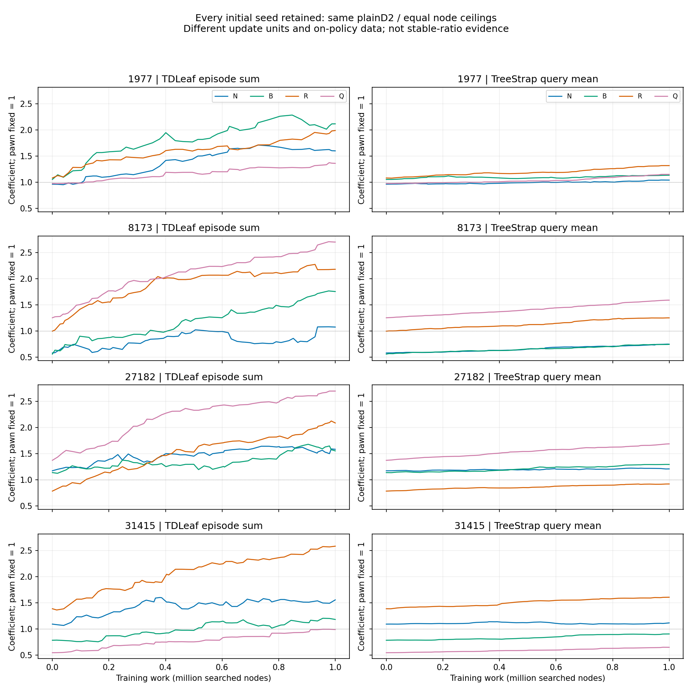
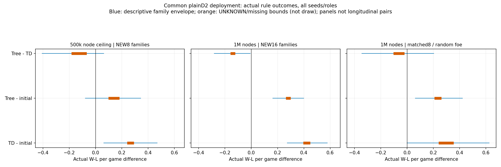
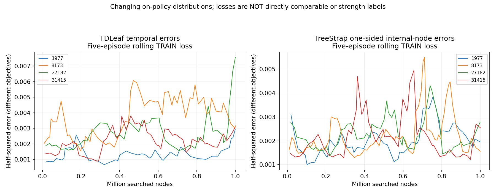
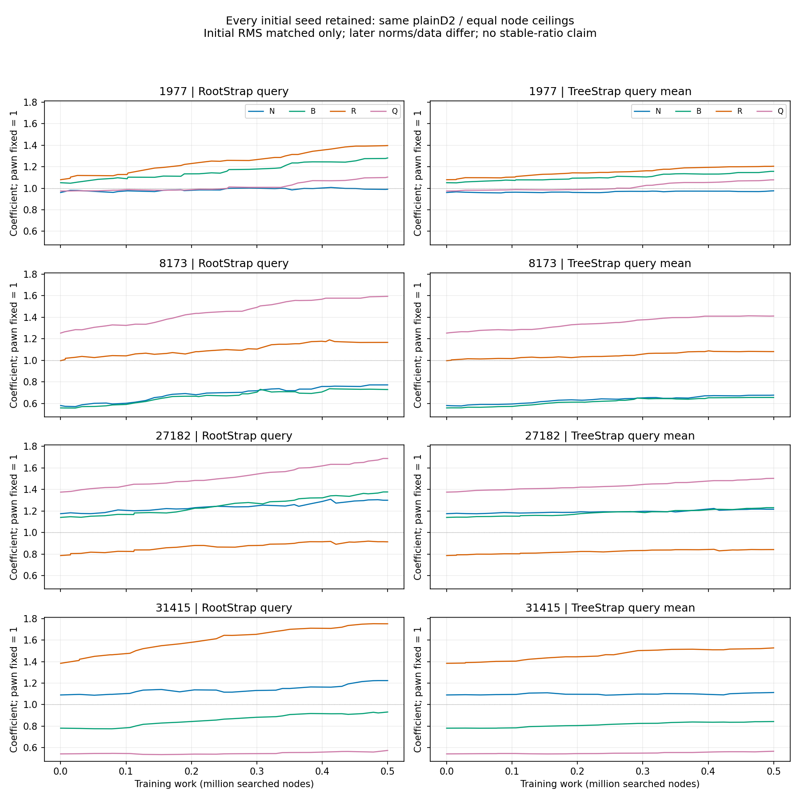

# Segment88: episode TD versus all-node search bootstrapping

The learning framework now has executed TDLeaf, mean TreeStrap and RootStrap
controls. StudyA's new16-family endpoint gives positive finite-panel gain bounds
for BOTH learners in ALL four initializations: TD[.40625,.4375], Tree[.2734375,
.2890625]. The crossed seed/family method contrast includes zero. Different-foe
and midpoint evidence remains wider; no general winning method is selected.
StudyB's root-only control gives+.125 versus Tree+.109375; Tree-minus-Root=-.015625
with crossed envelope[-.09375,0]. Initial RMS matching drifted to1.50-1.70times
larger actual Root update norms. Extra internal-node gradients are observed, but
an actual-strength advantage from them is NOT established here. Price orderings
remain different across initializations; no human prices are fitted.

All960 planned evaluation games returned:952actual terminals/8H512UNKNOWN,
zero failed evaluation queries and zero missing slots. Twelve million TRAIN nodes
produced711episodes/692actual terminals/19censors; all gradient updates and actual
legal histories were independently reconstructed. The total recorded7producer
cost is26,921,851nodes/3615.505seconds; this is not the complete engineering cost.

Next choose a changed TRAIN distribution/exploration premise, not more proof
coverage or an unchanged finite price grid. For example, a NEW16-vs64legal-prefix
comparison under the same incremental learner can test richer material-feature
exposure and cross-initialization consistency, with fresh actual-outcome
validation. Stable ratios and full Generic transfer remain OPEN.


Science OPEN. User TD/search-bootstrap priority continues; actual terminal W/L/D
evaluates strength. This is a complete learning-regime contrast under equal nodes,
not a pure node-information effect or faithful historical reproduction. Own
sidemission/PUBLIC; no PRIMARY/Core/product/default/UI changes or extra workers.

## Frozen comparison and actual training

[Method and deviations](METHOD_20261017_88.md); [before-run training plan](task2512/plan.json).
New81000+game legal16-ply prefixes; same plainD2/path-seeded coefficient-independent
search; four random initializations, pawn fixed1, tanh(material/10), no human weights,
qsearch/SEE/nullmove/TT/prover. TD episode-frozen lambda.95 sum versus TreeStrap
frozen-per-search MEAN one-sided internal-state loss; eta.05 in both is NOT equal
update unit/norm/frequency. Targets detached; gradients at PVleaf for TD and each
interior STATIC state for Tree. All interior nodes count in mean denominator.

Training COMPLETE: 8000000 attempted nodes / 1070.143s; 453 episodes = 442 real terminals + 11 censored.
Training self-play W/L counts are white-oriented outcomes, NOT independent strength estimates.

| Initial seed | Method | Games | W/L/D/U | Returned learning samples | Nonzero episode changes | Seconds |
|---|---|---:|---|---:|---:|---:|
|1977|td|44|13/14/13/4|9847|44|141.955|
|1977|tree|53|21/18/13/1|199912|53|137.007|
|8173|tree|74|39/29/5/1|182122|74|126.476|
|8173|td|59|21/27/10/1|6336|59|130.726|
|27182|td|56|25/21/9/1|7793|55|134.677|
|27182|tree|59|30/24/4/1|188388|59|131.105|
|31415|tree|54|18/20/15/1|204521|54|135.578|
|31415|td|54|24/8/21/1|8506|54|132.618|

Returned TD terms and Tree interior samples are DIFFERENT units/objectives.
All attempted/failed nodes paid; weights and all seeds retained, no fitness selection.
Node ceilings do not equal wall time or total-cost matched algorithms. Actual timing
includes logging/update/game handling; search receipts provide narrower search time.

## Actual strength under common deployment

All panels use fixed plainD2/8192nodes/5s/H512 and both candidate roles. Initial
baseline paid once per panel/foe/seed/family/role. U/missing outcomes remain[-1,+1],
never draws. Fixed slot shuffle is independent of outcomes, not random missingness.
Bootstrap envelopes are descriptive; four seeds reuse each family, not independent
games. A positive interval here is scoped utility, not unique/universal prices.

### endpoint

COMPLETE: 384/384 returned, 0 never started; 382 actual terminals, 2 U; 5498727 nodes / 734.113s.
[All actual records and query audit](task2514/endpoint-audit.json). Shared initial physical games: 128.

| Policy contrast | Pooled actual W-L gain bounds | Family95% envelope | Crossed seed/family95% envelope |
|---|---|---|---|
|td minus initial|[0.40625, 0.4375]|[0.2734375, 0.578125]|[0.03125, 0.8515625]|
|tree minus initial|[0.2734375, 0.2890625]|[0.1640625, 0.3984375]|[0.0, 0.59375]|
|tree minus td|[-0.1484375, -0.1328125]|[-0.28125, -0.0078125]|[-0.3984375, 0.1875]|

| Initial seed | TD gain bounds | Tree gain bounds | Tree minus TD bounds |
|---|---|---|---|
|1977|[0.125, 0.1875]|[0.375, 0.375]|[0.1875, 0.25]|
|8173|[1.0, 1.0]|[0.625, 0.625]|[-0.375, -0.375]|
|27182|[0.25, 0.3125]|[0.03125, 0.09375]|[-0.21875, -0.21875]|
|31415|[0.25, 0.25]|[0.0625, 0.0625]|[-0.1875, -0.1875]|

### midpoint

COMPLETE: 192/192 returned, 0 never started; 189 actual terminals, 3 U; 3062431 nodes / 419.471s.
[All actual records and query audit](task2514/midpoint-audit.json). Shared initial physical games: 64.

| Policy contrast | Pooled actual W-L gain bounds | Family95% envelope | Crossed seed/family95% envelope |
|---|---|---|---|
|td minus initial|[0.25, 0.28125]|[0.0625, 0.46875]|[-0.0625, 0.640625]|
|tree minus initial|[0.109375, 0.171875]|[-0.078125, 0.34375]|[-0.1875, 0.515625]|
|tree minus td|[-0.171875, -0.078125]|[-0.40625, 0.0625]|[-0.515625, 0.25]|

| Initial seed | TD gain bounds | Tree gain bounds | Tree minus TD bounds |
|---|---|---|---|
|1977|[-0.125, 0.0]|[0.1875, 0.1875]|[0.1875, 0.3125]|
|8173|[0.625, 0.625]|[0.375, 0.625]|[-0.25, 0.0]|
|27182|[0.25, 0.25]|[-0.125, -0.125]|[-0.375, -0.375]|
|31415|[0.25, 0.25]|[0.0, 0.0]|[-0.25, -0.25]|

### different_foe

COMPLETE: 192/192 returned, 0 never started; 189 actual terminals, 3 U; 3374211 nodes / 465.290s.
[All actual records and query audit](task2514/different_foe-audit.json). Shared initial physical games: 64.

| Policy contrast | Pooled actual W-L gain bounds | Family95% envelope | Crossed seed/family95% envelope |
|---|---|---|---|
|td minus initial|[0.25, 0.34375]|[0.0, 0.625]|[-0.125, 0.75]|
|tree minus initial|[0.21875, 0.25]|[0.0625, 0.421875]|[-0.015625, 0.5625]|
|tree minus td|[-0.09375, -0.03125]|[-0.34375, 0.203125]|[-0.4375, 0.25]|

| Initial seed | TD gain bounds | Tree gain bounds | Tree minus TD bounds |
|---|---|---|---|
|1977|[-0.0625, 0.0625]|[0.125, 0.25]|[0.1875, 0.1875]|
|8173|[0.6875, 0.6875]|[0.5, 0.5]|[-0.1875, -0.1875]|
|27182|[0.3125, 0.4375]|[0.25, 0.25]|[-0.1875, -0.0625]|
|31415|[0.0625, 0.1875]|[0.0, 0.0]|[-0.1875, -0.0625]|

Endpoint93000-93015 and midpoint94000-94007 use DIFFERENT families; their
difference is not a paired learning curve or monotonic convergence result. Midpoint
uses last CLOSED episode at/below500knodes; actual offsets saved in weights.json.
Different-foe panel uses the same first8 endpoint families93000-93007 with one
pre-fitness random foe seed18803, not selected/assumed stronger. Its initial
baseline is newly paid under that foe. Matched families are not new independent
holdouts; no new prices are selected from any panel. Original caps2100/1200/900/900
remain unchanged, including all failures and missing planned slots.

## Independent update, rule and search receipt checks

36 relevant tests PASS, including independent minimax intervals/finite-difference half-square MEANgradient, inactive bound denominator and fixed pawn.
Independent scalar Tree interval updates and forward-view TD recursion PASS all 453 episodes / 66493 attempted queries; all 73733 training+prefix plies replayed legally.
Prespecified first4queries perarm replay: 32 actual searches / 8288nodes, exact action/node/value/PV/Tree sample equality. This is same-source/rulelibrary replay, not external engine or every search.
Every query journals effective node/time limits, remaining panel time, actual reason
and work. This fixes87 missing historical effective-budget observability prospectively;
no old87 UNKNOWN is relabeled or old experiment restarted.

### td credit mechanism

```json
{
  "queries": 32493,
  "search_microseconds": 522960553,
  "td_terms": 32482,
  "nonzero_td_errors": 10235,
  "episodes": 213,
  "actual_terminal_episodes": 206,
  "nonzero_episode_updates": 212,
  "failed_query_nodes": 462
}
```

### tree credit mechanism

```json
{
  "queries": 34000,
  "search_microseconds": 510455828,
  "EXACT_samples": 85122,
  "EXACT_active": 32259,
  "inactive_bounds": 521312,
  "UPPER_samples": 368132,
  "UPPER_active": 87410,
  "root_active": 9656,
  "all_node_samples": 774943,
  "active_samples": 200768,
  "nonroot_active": 191112,
  "root_zero_tree_nonzero_queries": 12478,
  "delta_mean_l1_micro": 10423918,
  "delta_root_l1_micro": 9624486,
  "LOWER_samples": 321689,
  "LOWER_active": 81099,
  "nonzero_query_updates": 21405,
  "episodes": 240,
  "actual_terminal_episodes": 236,
  "nonzero_episode_updates": 240,
  "failed_query_nodes": 166
}
```

All-node sample count is not independent information count; inactive constraints
remain in denominator. Mean/root diagnostic impulses are hypothetical gradients at
the same recorded A models; no RootStrap policy was trained in StudyA. StudyB is separate.
Training losses are changing on-policy, different targets; no direct loss ranking.







## Interpretation and next decision

This completed contrast evaluates these retained implementations and distributions.
It does not estimate tuned-algorithm optimality, Elo, human price recovery, stable
universal ratios, pure all-node mediation or equal-total-cost WDL-grid superiority.
Final coefficient orderings and all four trajectories remain visible, never fitted
to human references. Full Generic-rule learning remains OPEN; future transfer must
use typed non-scoring guard2511, retain hand/base/promotion/history and owned LOSS
choices. No new Generic training or solver prerequisite here.

If a mechanism comparison remains useful, the next single changed premise is
RootStrap versus TreeStrap with same per-query static-state updates/target/loss,
and ONE initial TRAIN-only cross-seed RMS-gradient normalization including zeros.
The Dot-suggested control is executed as separate StudyB below; no tuned deployment result.
No extra q/proof-coverage campaign follows from this comparison.

Dot1792214792 reviewed inline design and reread paper only, no88source/execution.
Adopted node-static/PV distinction and mean/half-squared checks. Initially deferred RootStrap training until the A result; then executed the
separately registered StudyB below, without A eta/cap changes. PRIMARY c018 fixed
report was read87; no new PRIMARY execution/source review claimed in88. Exact raw
channel/thread/account outputs remain ignored/private. Delivery is not reading.

## Reproduction and boundaries

Exact executed raw sources/bytepins/all receipts and closed data are sealed in
DELTA_REPRO_20261017_88.zip with source closure; previous32 archives hash-checked
unchanged, not all old consumers rerun. Use exact ZIP for raw-pin replay; direct
Git text may have LF/EOF publication projection. Sensitive actual contents checked
before publication; private originals/paths/account metadata excluded. Fresh replay
and full remote/public verification are separately recorded, not inferred here.

Run closed-data audits from extracted archive (existing chess/pytest dependencies):

```powershell
.venv/Scripts/python.exe -m results.dev_aux.task2514.training_audit
.venv/Scripts/python.exe -m results.dev_aux.task2514.evaluation_audit endpoint
.venv/Scripts/python.exe -m results.dev_aux.task2514.evaluation_audit midpoint
.venv/Scripts/python.exe -m results.dev_aux.task2514.evaluation_audit different_foe
```

Training/evaluation commands reject pre-existing started markers; do not reset them.
Use NEW preregistered directories for future experiments. Scientific status OPEN.

## StudyB: align update timing/type and initial TRAIN-gradient RMS

This NEW study was registered after the A endpoint exposed the remaining update
confound, before any B calibration/training/fitness. It ran SERIAL after all A
producers closed; no A cap/price/seed was extended or modified. RootStrap and
TreeStrap both update STATIC states after each complete plainD2 search using
detached transformed half-squared targets. Root uses just the root; Tree MEANs
all returned interior nodes including zero loss. Targets are heuristic search
signals; actual full-rule W/L/D still evaluates strength.

The sole TRAIN-only global factor is c=1.411723953606143: initial gradient RMS Tree=0.00845144262799854, Root=0.005986611338859811, including all128 samples/zeros (Tree16,Root68).
Tree eta=0.05; Root eta=0.07058619768030718. No learning-rate grid, deployment outcome fitting, zero-signal rescue or later retuning.
Calibration32NEW shared families101000-101031/64randomlegalplies differs from
16ply self-play starts. Matching is INITIAL and global over the four seeds only;
later norms/data can drift, so this still cannot identify a pure information effect.
[Independent scalar calibration audit](task2520/calibration-audit.json).

Training COMPLETE: 4000000nodes/532.337s, 258episodes = 250actualterminal + 8censored. All4initials x Root/Tree x500knodes; NEW82000+episode prefixes. Original900second aggregate cap.
Independent ALL-query static gradients/actual histories PASS: 34827queries, 38947legalplies. No TD updates in B.

| Seed | Method | Games | W/L/D/U | Samples | Seconds | Final weights P/N/B/R/Q |
|---|---|---:|---|---:|---:|---|
|1977|root|31|15/8/7/1|4413|68.554|[1.0, 0.9906756713727058, 1.2813386511683766, 1.3965333390593806, 1.1037161238996338]|
|1977|tree|33|16/9/7/1|95469|67.459|[1.0, 0.9759735457269888, 1.1568572822112908, 1.2044700656161649, 1.0778926550133308]|
|8173|tree|39|17/17/4/1|92276|65.737|[1.0, 0.6771094068005824, 0.6555697591924763, 1.0817409421503374, 1.411872814958385]|
|8173|root|37|18/14/4/1|3959|65.517|[1.0, 0.7722948005181869, 0.7293984657958964, 1.1671250259386807, 1.5946604163136517]|
|27182|root|33|13/16/3/1|4170|64.302|[1.0, 1.2994836947381225, 1.3766501138825509, 0.9135111879323511, 1.6874944570365256]|
|27182|tree|33|12/17/3/1|97893|65.050|[1.0, 1.2160057722864945, 1.2309127987390778, 0.8417440024308687, 1.5029864628301115]|
|31415|tree|26|9/12/4/1|105613|68.195|[1.0, 1.1127080036812464, 0.8431108224010352, 1.5267355172072972, 0.5670725659902762]|
|31415|root|26|10/11/4/1|4934|67.523|[1.0, 1.2235249873514327, 0.9315189517670311, 1.7509600309372881, 0.5745927962583002]|

### Actual update-scale drift

| Seed | Root query-update RMS | Tree query-update RMS | Root / Tree |
|---|---:|---:|---:|
|1977|0.000818367603|0.000529174766|1.5465|
|8173|0.000844930073|0.000565053608|1.49531|
|27182|0.000905181494|0.000533798775|1.69574|
|31415|0.000780328008|0.000505564908|1.54348|

These are changing on-policy QUERY norms including zero updates, not the frozen
calibration distribution. Different query counts/paths and any drift remain
interpretation limits. No retuning uses this table. Root and Tree now have the
same update unit/target type, but the initial calibration alone is not a permanent
norm constraint.

### NEW8family common deployment: COMPLETE

192/192games returned; 192realterminals, 0U, 0missing. 2957972nodes/389.204s. Families95000-95007/all4seeds/bothroles; uniformfixedfoe/PLAIN D2/8192nodes/5s/H512. Initial physical baseline64paidonce, original600secondcap.

| Policy contrast | Pooled W-L gain bounds | Family95% envelope | Seed/family95% envelope |
|---|---|---|---|
|root minus initial|[0.125, 0.125]|[0.015625, 0.234375]|[-0.109375, 0.359375]|
|tree minus initial|[0.109375, 0.109375]|[0.0, 0.203125]|[-0.109375, 0.34375]|
|tree minus root|[-0.015625, -0.015625]|[-0.046875, 0.0]|[-0.09375, 0.0]|

| Initial seed | Root gain bounds | Tree gain bounds | Tree minus Root bounds |
|---|---|---|---|
|1977|[0.0, 0.0]|[0.0, 0.0]|[0.0, 0.0]|
|8173|[0.375, 0.375]|[0.375, 0.375]|[0.0, 0.0]|
|27182|[-0.0625, -0.0625]|[-0.0625, -0.0625]|[0.0, 0.0]|
|31415|[0.1875, 0.1875]|[0.125, 0.125]|[-0.0625, -0.0625]|



Eight families are repeated across seeds/roles; descriptive envelopes do not
make them64independent families. U/missing bounds stay distinct from draws.
StudyB has NEW training/validation distributions and half the perarm nodes of
StudyA final endpoints; it is not an additional paired A curve or a fair total-cost
ranking against TD/grid/human prices. Stable material ordering and full Generic
transfer remain OPEN.

## Recorded whole-segment producer cost

Training time alone is not evaluation or total engineering cost. Every actually
executed initial baseline is counted once perpanel/foe. No old producer was
restarted; all failures and unused portions of frozen caps remain visible.

| Producer | Nodes | Actual seconds |
|---|---:|---:|
|A_TRAIN|8000000|1070.143|
|A_endpoint|5498727|734.113|
|A_midpoint|3062431|419.471|
|A_different_foe|3374211|465.290|
|B_initial_calibration|28510|4.948|
|B_TRAIN|4000000|532.337|
|B_endpoint|2957972|389.204|

Total recorded producer work: 26921851nodes/3615.505s. Session elapsed, audits, engineering and delivery are separate. Concurrent machine load is an interpretation limit, not a rerun/quiet-window gate.

Both studies retain ALL initializations and fixed conditions; no winner seed,
best checkpoint or human price is selected. A next experiment must change one
stated premise and use NEW inputs, not extend these caps.


## Post-seal reproduction and collaboration qualification

The33rd immutable capsule has197payloads/18,295,913bytes, SHA256
1375cf3eb50a2818407791cfb32bb0d142daa1b77e7abaf0c36c8bbcfcf88717.
The first isolated replay passed35tests but one inherited real-q-evasion test
could not find its DATA fixture task2505/queries.jsonl; import-closure collection
had missed that dependency. No numeric audit ran after that test failure.
Original capsule/launcher/failure logs remain unchanged. This is a transport
failure, not a repaired learner or an excuse to rerun training/evaluation.

Corrected [fresh_v2.py](task2515/fresh_v2.py) restores ONLY that file from the
unchanged87capsule after checking its full archiveSHA and fixtureSHA. It then
parks sealed derived copies and REGENERATES all auditors in a NEW UUID tree.
36tests PASS; all711training updates/960actual game records/128calibration rows
match, covering281024legalplies in37.432s. Same rulelibrary/source arithmetic,
not freshtraining/externalengine. See [receipt](task2515/fresh-receipt.json),
[transport correction](FRESH_TRANSPORT_FIX_20261017_88.json) and
[entrypoint/dependency instructions](task2515/README.md). Downloading88ZIP alone
is insufficient for the inherited fixture; v2 and87ZIP are explicit dependencies.
The exact v2dispatcher SHA is36c21d3079070c13cb73f592aac756c944a1ed8cc705ac33f55ead9794e96840.

A later complete88thread read recovered PRIMARY1792216878.043419. Its fixed
629fd5d4a350fbee4705738067c17f80af20bf83 report's new sections were anonymously
READ here, not its executions rerun. It reports CLOSED48017completed87queries,
7998701nodes/1074.125s, correcting the earlier350abb RUNNING status. Original
8failed queries remain skipped/retained. Its two owned Core predicates now reject
actual non-scoring declarations before trajectory TD/arena scoring. The carrier
is current callable code, not merely retired code; PRIMARY fixed its sites and
AUX2511guards its adapter. No automatic merge or local Core repair is claimed.
PRIMARY's3243/59/7/104test tiers are its reports, separate from ours36.

Its small zeroRoot examples are not representative failure proofs: the full
historical87root census has nonzeroRootRMS in all8arms. No multiplier is fitted
from those exposed trajectories; our new128initialTRAIN calibration is distinct.
See [late scope/adoption record](LATE_ADVISOR_20261017_88.json). PRIMARY/Dot88
source-reading/execution remains unconfirmed. This live report includes these
post-seal amendments; the raw ZIP retains the earlier executed-evidence snapshot.
No scientific source, weight, actual outcome, cap or archived data was altered.
