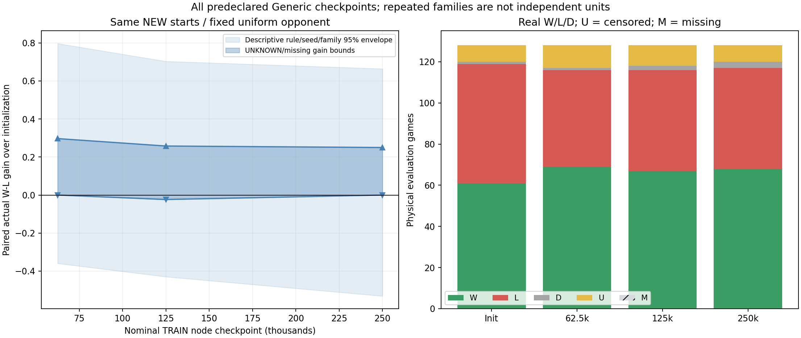
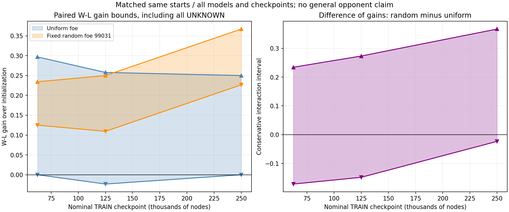
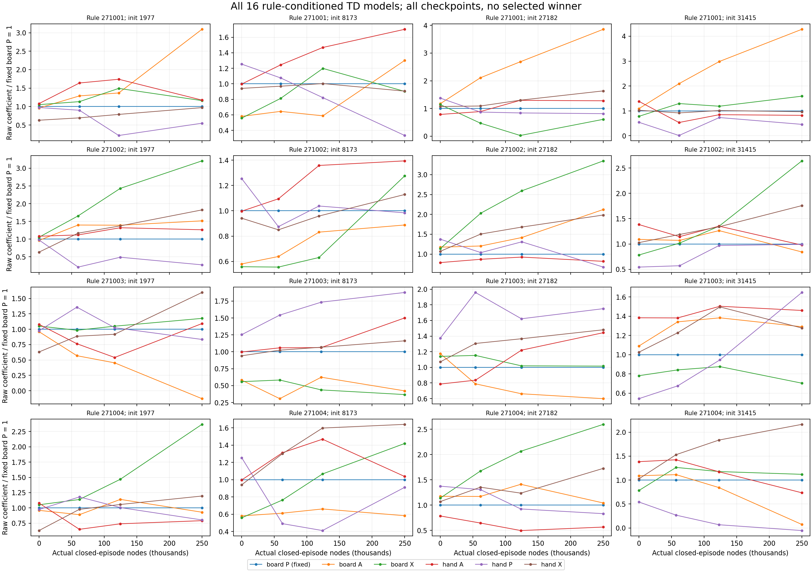
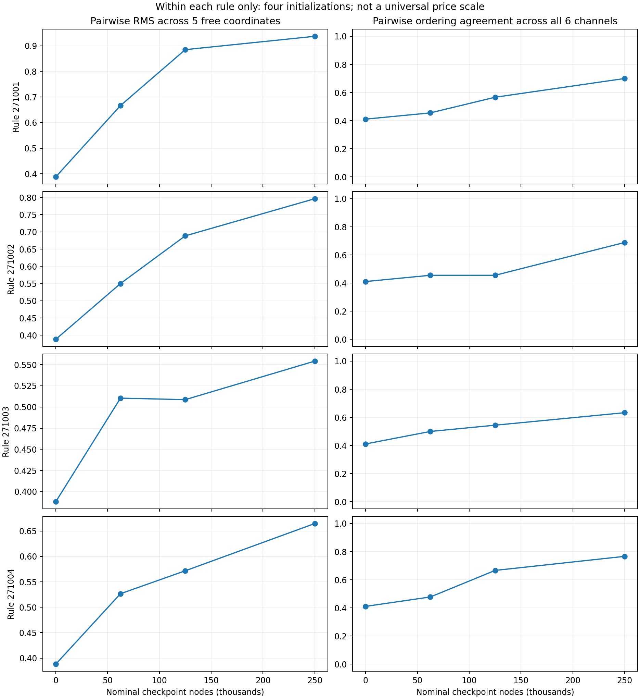
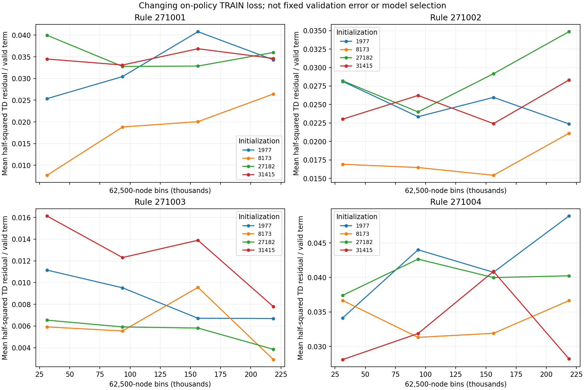

# Segment90: actual Generic TD learning curve

The SAME incremental learner now completes a substantially larger Generic study.
It improves actual W-L in two of four tested rule families, but results remain
initialization- and opponent-dependent. This is evidence for scoped learning,
not stable/universal prices or full generated-domain generalization. Science OPEN.
Own sidemission/PUBLIC; PRIMARY read only; no Agent/Goal/worker/default/Core/UI change.

## What actually ran

ALL four saved89 generated4x4promotion/drop rules, four initializations, fresh
models/NEW121000+game TRAIN binding streams, SAME episodeTD(.05,.95)/plainD2.
ALL16arms exactly250000nodes;4Mnodes in1971.885seconds.4697episodes:
4628actualterminals/69UNKNOWN,3098nonzeroepisodeupdates.61260queries,
61244commits,3300promotions/16375drops,61175validTDterms/41297nonzeroerrors.
Independent scalar reverse-credit and all full-history checks PASS; all48fixed
closedepisodecheckpoints bound.16finalsmallpoolfailures cost546nodes; no ordinary
full4096query failures.53H128censors+16resourcecensors remainUNKNOWN. Medianplay
length5plies (range0..128); large episode count is not itself strength evidence.

No WDL-grid acceptance, quantity reward, mateprover/table/teacher/default changes.
Actual rule maxply512 unchanged; H128 is this NEW regime, not extension of old89
H64 and not a pure old89 update-count comparison. Midpoint model work lags the
nominal target by5..8913nodes; final16models all useexact250000 includingfailedwork.
All rawweights/checkpoints retained, no interpolation/bestcheckpoint/price/seed fit.

## Actual strength, all registered points

Two512game panels were registered BEFOREANYfitness: commonNEW131001..4 binding
families, BOTHroles, ALLmodels/checkpoints, initialization paid ONCE perpanel.
Secondpanel uses SAME roots and randomfixedfoe99031, notknownstronger. Original
1000second caps unchanged; second activated bytime only afterfirstclose.
Uniform512:475actualterminals/37H128U/0missing/0failedqueries,717996nodes324.076s.
Randomfoe512:495terminals/17H128U/0missing/0failedqueries,646915nodes265.776s.

Gain is mean actual W-L over initialization. Bounds allow ALL unknown/missing
outcomes[-1,1]; these finite-panel bounds are NOT confidence intervals.

|Nominal nodes/model|Uniform foe gain bounds|Fixed random foe gain bounds|
|---|---:|---:|
|62500|[0, 0.296875]|[0.125, 0.234375]|
|125000|[-0.0234375, 0.257812]|[0.109375, 0.25]|
|250000|[0, 0.25]|[0.226562, 0.367188]|

Final rule271002 gains .3125/.625, rule271004 .375/.625 underuniform/randomfoes.
Rule271001 is0/.125. Rule271003 remains unresolved: [-.6875,.3125] and
[-.46875,.09375]. Seed31415 final uniform gain[-.3125,-.0625], random[-.25,0];
it is NOT dropped. Uniformfinal descriptive rule/seed/family95envelope
[-.53125,.6640625], random[-.390625,.890625]: neither proves population benefit.
Intermediate points also retained; no monotonicity or chosen stopping point.

All price-first divergences occur on candidate turn; matchedopponentswitch has
312foe-first divergences/200identicalfullrecords across512policy pairs. Final
interaction bounds[-.0234375,.3671875] include0, not equivalence/opponent invariance.
Independent outcomes/roles/weights/budgets/fullrecords checks PASS. Repeated
families are shared across seeds/checkpoints/roles, not512independentroots.

## What did not converge, and what the sample actually contains

All four rules start16actors on16cells. These are ordinary generated promotion/
drop rules, not sparse endgames, custom auxiliary DSL coverage or unseen rules.
Of16new PRNG rule-family root draws, all16fullrecords distinct,4already appeared
asactualTRAIN roots,4arealreadyterminal. Neither set was filtered. New stochastic
seeds must not be advertised as16strictlyunseen states. All1024initialrecords
independently regenerated from frozen draws; actual overlap and attemptedmass kept.

Within-rule cross-initialization free-coordinate RMS rises from .3880 to
.9372/.7963/.5542/.6648. All-channel order agreement rises from .4111 to
.7000/.6889/.6333/.7667. Increased order agreement is not numeric price convergence.
Channels distinguish board-current from hand-base; this is not human piece ranking.
Changing on-policy TRAINloss is not a fixed validation loss, and does not steadily
fall for every rule/initial. All5figures visually checked, no selected panels.

## A concrete next model-class question, already begun at component level

GeneratedP has arbitrary movement. Fixed boardP=+1 excludes zero/negativeP and,
with fixedtanhscale10, restricts amplitude/learning dynamics. It is not merely
unit normalization. Dot1792227407 supplied math/inline design advice only, no90
source/execution; exact request/readback/reply privately preserved/reconciled.
Keep common10 as parameterization, not proven calibration; no TC/prover/API gate.

Afterall90learning/fitnessclosed, new2532FreeModel implements ALLsixfreecoords
without modifying oldModel. Frozen preflight uses FIRST actual terminal TRAIN
episode witha nonterminalPV Pfeature!=0 (EXPOSED unitfixture, notnewtrainingmu).
Six numerical partials atone actualPVvector match (twoactivecoordinates); explicit
P-only update isrespected; sameinitialvectors yieldidenticalD2 action/value/PV/
nodecount in2real queries/78nodes. The contiguous6-query realepisode/publicterminal
is independently re-differentiated: oldfixedupdate exactly reproduced, newrawP
1 -> .9850329640151471. This is a credit/APIpreflight, NOT new selfplaytraining,
newheldoutfitness, negativePbenefit, sixfreeperformance or whole-domain proof.

NEXT fullstudy must pair5fixedP-vs6free onSAME NEWTRAIN/initialvectors/budgets,
NEWsharedvalidation andallinitials, not compare new6free toold90. ReportP/norm/sign
crossings andposthocL2direction (zeroUndefined); no per-update/deploymentrenorm.
No human-value fitting or oldcaps restored. Fullclassical replication, stable
ratios, strongersearch transfer and completegenerated-domain learning stayOPEN.

## Correctness, cost, preserved errors and transport

ALL48preselected queries verified byindependent UNPRUNED D2 minimax, committed
fulltypedaction andselectedPV leafwitness:10054nodes4.838s underoriginal180s cap.
This is not allinterior-bound replay or true-WDL proof. Ruleauthority is sharedCore,
not an independent externalengine. V1TRAIN/fullprefix replay351.756s anduniform
105.587s bothPASS. Exactexecutedsources/results preserved. V2incrementalpublicsubmit,
EVERYqueryfullrecordidentity andfinalpublicreplay reproduces ALLmetrics/counts:
46.629s/10.937s observed; differentconcurrentload, not a controlledspeedup claim.
RandomfoeV2audit8.705s; itsv1 draft explicitly UNEXECUTED. All107984logical
recordplies/85689producerqueries preserved; internalCore calls are a different count.

Privatev2entry first failedmoduleimport beforeany audit; owncwd sys.path fix
restored it. Initialpre-fitnesslogicalbytepin/missing-slot harnessamendments are
preserved. Machinehostname removed onlyfrompublicJunitcopy, rawprivate kept.
No failure/UNKNOWN/model deleted. See FAILURES and METHOD for exact boundaries.

Threeactualproducer cost5,364,911nodes/2561.736s excludescompleteengineering,
audit/test/plot/Git/Slack/token cost. Originalverification+component queries bring
listedsearchworkto5,375,043nodes; not allprojectCorework. Sessionclock separate.
38existingrelatedpytest controlsPASS; sixfreecomponentpreflight additional. No full
PRIMARY/Native rerun, productmerge or generalizedproof claim. PRIMARY0e/ea06 selected
report previouslyREADonly; no independentexecutionhere/ownerstatewrites.

35th exactsource/datadelta andprior34hashcheck are next publication checkpoint.
Large queryjournals are PUBLIC INSIDE the ZIP atunchangedrelativepaths, notoversized
Gitblobs; JOURNAL_ROUTES binds exactbytes. Newignored-source38controls andall derived
audits must actuallyrerun with sealedoutputs parked first. Atsealtime this fresh
consumer is not yet claimedPASS; its lateractualreceipt and explicitpostseal section
will record result. RawZIPbytepins stay authoritative; GitLF/EOFprojection separate.
No visibilitychange; anonymousPUBLIC fixedrevision verification andDot evidence
are recorded onlyafteractualdelivery. Sending is not reading/execution.

## Postseal actual fresh-source result

The newignoredUUID consumer ACTUALLYPASS38relatedtests andALL9REGENERATED
outputs,107984logicalrecordplies in78.494seconds. Sealedderivedoutputs were
parked BEFOREcompute, extractedsource originasserted/Python-S/emptyPYTHONPATH;
all numbers/counts equal exceptauditwalltime. Includes independent48unpruned
contexts andsixfreecomponent replay, realowner+PRIMARYstopflags, no fakeflags.
This is Windowsownerexecution, not a portableLinuxwrapper or Dotexecution.
35thZIP196payloads425524925uncompressedbytes/10222982compressedbytes,
SHA c682ab793866421f014c3b81ec730747265ffca26cba78449d1aecee787d55a0.
Prior34archivehashes unchanged, notalloldconsumersrerun. This paragraph andfresh
receipt are AFTERsealing, outsideimmutableoriginalsnapshot. No rawsource/data/
model/cap/failure rewrites. Gitpublication/anonymousPublic/readingstatus still
requireactualdeliveryreceipt, notthissuccessful localconsumer.
