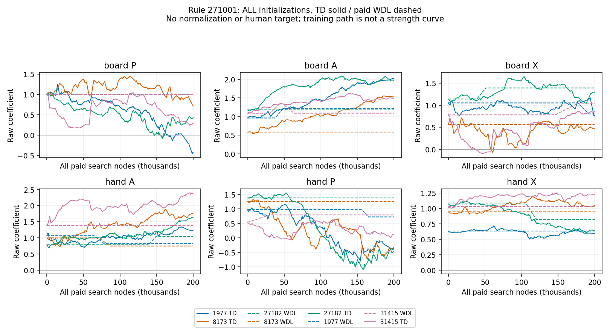
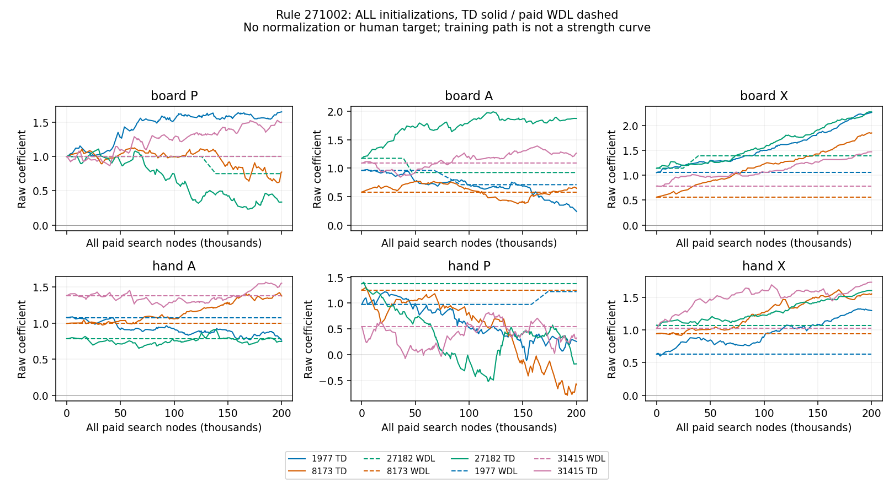
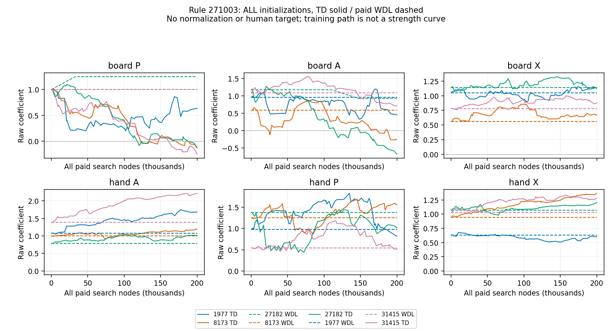
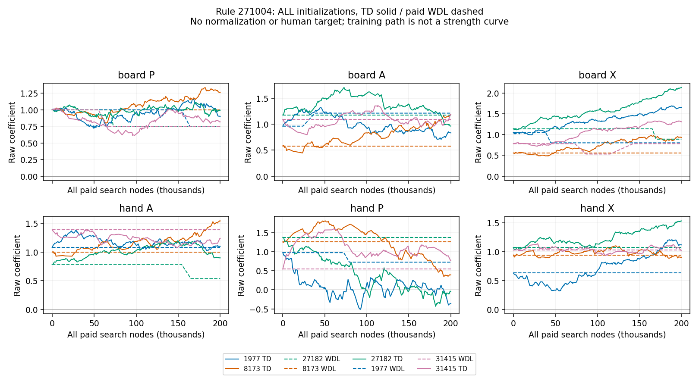
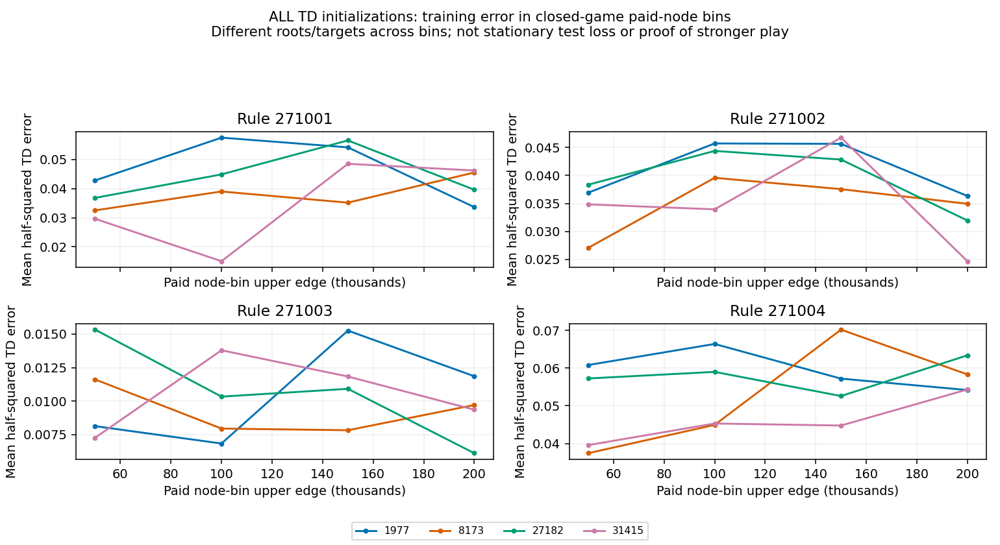
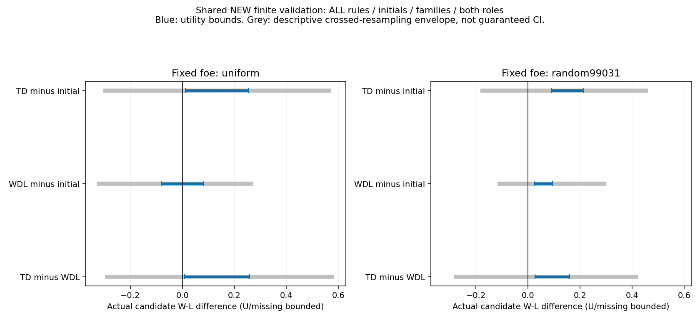
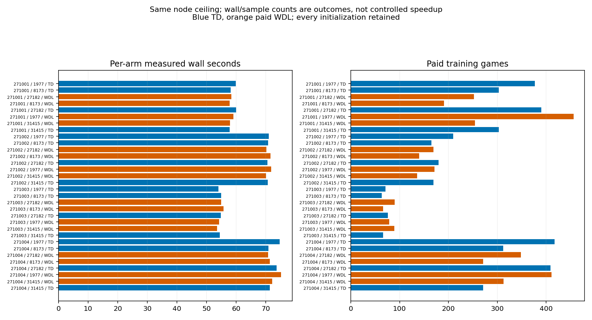
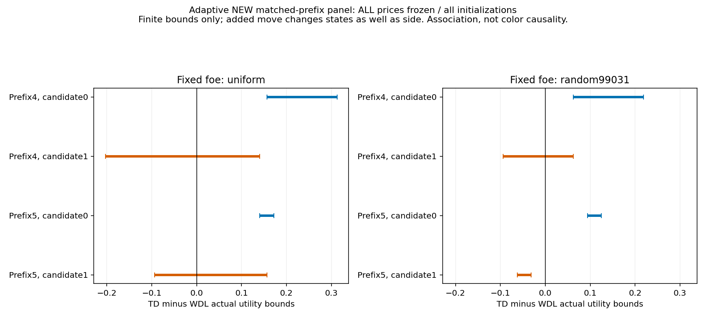

# Segment92: same-engine TD versus paid terminal-WDL

Scientific status **OPEN**. This is the direct user-requested learning-method comparison, continuing the incremental TD/search-bootstrap route. Existing Chess studies remain the scoped first-stage evidence; this is not a literal historical replication, stable-price solution or all-generated-domain result. Own sidemission/PUBLIC only; no PRIMARY/Core/product/default/UI changes.

TD has a strictly positive finite-panel utility lower bound against paid WDL on BOTH fixed opponents. These are finite-cell bounds, not a population ranking or stable-price result. TD-initial lower bounds: {'uniform': 0.01171875, 'random99031': 0.08984375}; WDL-initial lower bounds: {'uniform': -0.08203125, 'random99031': 0.0234375}.

Adaptive followup qualification: after prefix5 changes the ongoing side to move, player0 advantage persists. In the random-foe prefix5 stratum, TD-WDL candidate0=[.09375,.125] butcandidate1=[-.0625,-.03125]. Thus a simple first-action-only explanation is insufficient; this is not proof of a sign bug or unique role-context cause. Keep TD as a candidate with scoped finite-panel utility gain, not a universally superior or role-stable price learner.

## Actual cost and training

All 32/32 registered arms returned; TRAIN status COMPLETE, 6,400,000 paid search nodes in 2051.774s. 7218 games, 7046 actual terminals, 172 UNKNOWN. Every current/proposal/opponent/incomplete search counts. Original3600s cap and200k/arm ceilings are unchanged.

| Method | Paid nodes | Games | Nonzero updates | Proposal blocks | Sum of arm wall seconds |
|---|---:|---:|---:|---:|---:|
| TD | 3,200,000 | 3782 | 2490 | 0 | 1027.268 |
| WDL | 3,200,000 | 3436 | 29 | 220 | 1024.488 |

The shared FreeModel has all six raw signed coefficients, scale10, plain full-widthD2,4096nodes/2s per query, H128, fixed uniform TRAIN opponent, four saved promotion/drop rules and all four initial vectors. New TRAIN families181000 onward. Parameters remain rule-conditioned. Nodes are a common search-work ceiling; wall/game/update counts are observed consequences, not controlled speedup or equal step size.

Independent full-history/credit audit: 113,660 actual queries; 28,657 candidate-decision TD terms; 220 paid WDL proposals, 29 accepted. Missing proposal-tail games 84 are bounded, not completed. Failed TRAIN queries 32, consuming 1502 nodes; full4096-limit failures 0. Actual black-candidate/white-foe-terminal credit controls: 506.

## Actual held-out-recipe strength

All 1536/1536 shared registered slots returned (0 missing): 1473 actual terminals, 63 UNKNOWN, 1,932,445 nodes/588.583s. NEW191001..191008 families, both roles, initial/TD/WDL and two fixed opponents. Unknown/missing reward remains[-1,1]; bounds below are candidate W-L differences, not win probabilities.

| Fixed opponent | Contrast | Finite-panel utility bounds | Descriptive crossed95 envelope |
|---|---|---|---|
| uniform | TD minus initial | [0.01171875, 0.25390625] | [-0.3046875, 0.5703125] |
| uniform | WDL minus initial | [-0.08203125, 0.08203125] | [-0.328125, 0.2734375] |
| uniform | TD minus WDL | [0.0078125, 0.2578125] | [-0.296875, 0.58203125] |
| random99031 | TD minus initial | [0.08984375, 0.21484375] | [-0.18359375, 0.4609375] |
| random99031 | WDL minus initial | [0.0234375, 0.09375] | [-0.1171875, 0.30078125] |
| random99031 | TD minus WDL | [0.02734375, 0.16015625] | [-0.28515625, 0.421875] |

The primary contrast is TD minus paid WDL at the same node ceiling. Both initial controls are required. A positive finite-panel lower bound establishes a result for these registered cells even with unknowns; it is not a population guarantee. A crossed-rule/seed/family envelope containing zero is not equivalence. The second opponent is different random99031, not assumed stronger. Per-rule, per-seed, per-role and every adverse initialization remain in the [audit](task2541/evaluation-audit.json).

Root audit: 32 registered roots, 32 distinct full records, 4 overlap current TRAIN, 1 already terminal. None filtered. Rules are TRAIN-exposed and older exposure is not excluded. New PRNG families do not establish strict unseen-state generalization.

## Information use, stability and limitations

Natural negative control: 6 exactly unchanged models, 192/192 paired complete-query deployments have identical full records/rewards; resource-unknown 0, missing 0. All such arms retained, not selected by fitness.

Matched opponent interaction, (TD-WDL)@random minus (TD-WDL)@uniform: finite bounds [-0.23046875, 0.15234375]; descriptive95 [-0.765625, 0.5703125]. Zero-containing intervals do not establish opponent invariance.

| Method | Candidate / foe queries | TD observations / terms | WDL proposals / accepts | Identical WDL pairs / missing pairs |
|---|---:|---:|---:|---:|
| TD | 28758 / 28422 | 28747 / 28657 | 0 / 0 | 0 / 0 |
| WDL | 28300 / 28180 | 0 / 0 | 220 / 29 | 1363 / 46 |

| TD target source | Terms | Nonzero eligibility-error terms | Gross eta-scaled absolute credit |
|---|---:|---:|---:|
| next_search_material_PV | 23233 | 16925 | 268.704 |
| next_search_terminal_PV | 2444 | 2401 | 230.301 |
| actual_game_terminal | 2980 | 0 | 0 |

The actual game-endpoint terms number 2980, with 0 nonzero credit terms. Here the last candidate prediction already matches the actual endpoint. Earlier transitions into a searched rule-terminal PV supply 2401 nonzero credit terms; a zero gradient at the terminal PV does not erase earlier eligibility. This is not a quantity label. It does not establish strength without actual validation.

Gross absolute credit is summed before cancellation, not a share of net parameter movement or causal gain. Full counts and every per-arm result remain in [feedback diagnostics](task2541/information.json) and [anchor-timing interpretation](task2541/credit-interpretation.json).

These are actual signal and policy-sensitivity counts, not commensurate information bits. WDL pays both arms and can reject ties/uncertain panels; TD receives multiple approximate temporal constraints. Different update rules, proposal magnitudes, eligibility clocks and exploration remain part of the operational comparison. A negative result does not rule out terminal learning with other proposals/selection. Training loss is recorded by paid-node bins for every TD initialization in [diagnostics](task2541/diagnostics.json), alongside actual strength. Those bins visit different roots and are not a stationary test loss. Lower bootstrap loss alone proves no strength gain.

Raw weights and posthoc L2 directions are retained without training/deployment renormalization. Material weight dispersion or a finite observed feature span does not prove unique identifiable rule prices; this study does not fit human prices or read Xiangqi holdout labels. A generic P is not a Chess pawn. The complete feature model is only six material counts, although GameSession execution preserves promotion, drops and relevant full history. Auxiliary/custom-DSL full-domain learning remains unproved.

## Correctness and reproduction

Full typed histories and independent reverse TD/strict WDL selection arithmetic passed. First-rule1.6M-node prefix was audited during training, before fitness. Existing38 controls passed. Outcome-independent unprunedD2 verification: 64/64 planned candidate queries, 10808 nodes, status COMPLETE; committed full child and PV witness checked. This shares Core rule authority and is not an independent rules engine or every-query search proof.

The exact37th source/data capsule and fresh execution have separate actual receipts: [reproduction procedure](task2542/README.md). Do not infer PASS from the existence of this report. All previous36 immutable capsules and actual failures/partial work remain. Large query journals are public inside the ZIP; the route manifest identifies them. No cap reset or strength rerun occurred.

A separately preregistered, serial TRAIN-only D3 cost probe has 4 root records/793 nodes/0.274s. It uses uniform initial weights, NEW201001 roots, <=2s/16384nodes per query and12s aggregate. It is feasibility evidence only, not D3 price benefit or deeper-opponent validation. [Actual probe](task2543/result.json).

## Decisions and partner evidence

Retain TD/search bootstrapping as a main candidate and terminal-WDL selection as the specified control. Evaluate the direct actual-strength bounds and all adverse cells before choosing a next comparison; do not replace missing signal with quantity rewards, human targets or a prover-coverage campaign. No method is declared universal or equivalent from this panel. The all-arm parameter/strength figures and actual feedback counts distinguish learning behavior from final utility.

Dot1792231880.593939 supplied inline mathematical design advice, not source/execution review of92. Candidate-turn clock/white-coordinate/paid-cost qualifications were adopted and actually checked. Recovery/checkpoint new channel roots and relevant complete threads had no new peer updates at the recorded coverage. PRIMARY0ca265c711f55514b10ac06638b6934b159a81fc was previously read here; its89 replication and Native precision checks remain owner-reported, not92 execution/adoption. Source delivery, reading and execution are separate states. A later fixed-SHA evidence send will have its own receipt.

## Figures

Whole Agent segment duration/ending and final full remote/Public delivery are recorded separately after the official session finish; these producer wall times exclude complete engineering, audits, transport and token cost. No research is authorized by an ending receipt itself.

## Separate adaptive matched-prefix followup

After inspecting the original role asymmetry, ALL existing models were frozen. NEW211001..211004 families, both candidate colors, two fixed foes and matched4/5-action prefixes produced 1536/1536 slots, 1484 actual terminals, 52 UNKNOWN, 0 missing, 1,266,773 nodes/385.882s; original900s cap unchanged. No retraining/price selection or original cap extension. Full history/outcome audit passed. Parent-to-child extra legal edges 14, terminal parents retained 2.

Original root replay established31 ongoing player0-to-move roots and1 already terminal root. The followup changes actual positions/history as well as side-to-move; this is an initiative/input-distribution association check, not a pure color intervention. Ordering is canonical by full prefix action count. The full stratification audit was prepared after the followup started but before inspecting its outcomes; its timing is recorded, not mislabeled wholly pre-query.

| Foe | Prefix length | Contrast | Finite utility bounds | Candidate0 | Candidate1 |
|---|---:|---|---|---|---|
| uniform | 4 | TD-initial | [-0.015625, 0.265625] | [0.15625, 0.34375] | [-0.1875, 0.1875] |
| uniform | 4 | WDL-initial | [-0.0859375, 0.1328125] | [-0.09375, 0.125] | [-0.078125, 0.140625] |
| uniform | 4 | TD-WDL | [-0.0234375, 0.2265625] | [0.15625, 0.3125] | [-0.203125, 0.140625] |
| uniform | 5 | TD-initial | [0.0234375, 0.1640625] | [0.140625, 0.203125] | [-0.09375, 0.125] |
| uniform | 5 | WDL-initial | [-0.0625, 0.0625] | [-0.03125, 0.0625] | [-0.09375, 0.0625] |
| uniform | 5 | TD-WDL | [0.0234375, 0.1640625] | [0.140625, 0.171875] | [-0.09375, 0.15625] |
| random99031 | 4 | TD-initial | [0.0078125, 0.1640625] | [0.046875, 0.203125] | [-0.03125, 0.125] |
| random99031 | 4 | WDL-initial | [-0.0078125, 0.0546875] | [-0.078125, 0.046875] | [0.0625, 0.0625] |
| random99031 | 4 | TD-WDL | [-0.015625, 0.140625] | [0.0625, 0.21875] | [-0.09375, 0.0625] |
| random99031 | 5 | TD-initial | [0.0625, 0.09375] | [0.125, 0.15625] | [0.0, 0.03125] |
| random99031 | 5 | WDL-initial | [0.03125, 0.0625] | [0.03125, 0.03125] | [0.03125, 0.09375] |
| random99031 | 5 | TD-WDL | [0.015625, 0.046875] | [0.09375, 0.125] | [-0.0625, -0.03125] |

| Foe | Actual root side matches candidate | TD-WDL bounds | Pairs |
|---|---|---|---:|
| uniform | True | [0.03125, 0.234375] | 128 |
| uniform | False | [-0.03125, 0.15625] | 128 |
| random99031 | True | [0.0, 0.09375] | 128 |
| random99031 | False | [0.0, 0.09375] | 128 |

Matched prefix5-minus-prefix4 TD-WDL bounds: [{'foe': 'uniform', 'prefix5_minus_prefix4_TD_WDL_bounds': [-0.203125, 0.1875]}, {'foe': 'random99031', 'prefix5_minus_prefix4_TD_WDL_bounds': [-0.125, 0.0625]}]. These are conservative finite-panel intervals, not a causal initiative effect or population/equivalence test.

Roots registered 32, distinct full records 30, already terminal 5, original TRAIN overlap 5, original EVAL overlap 0. None filtered. Exact unchanged-model controls: {'models': 6, 'identical': 192}. All per-rule/per-initial strata remain in the [followup audit](task2544/audit.json).

This additional panel does not replace, pool away or hide the original registered comparison. No parameter choice is made from either evaluation. The remaining priority is to test incremental learning and its distribution/role dependence, rather than resume quantity rewards, human-price fitting or prover coverage as a prerequisite.

Official segment92 ended at2026-10-17T12:49:16.118920+00:00, 81.393minutes, safe_checkpoint/6researchstages. Source3792d83068d5d0e61a0a33ebbf6850b414202c6f was pushed and fullremote/anonymousPublic39files+ZIP verified before finish; fixedSlackevidence1792241036.833709 exactreadback. Late Dot1792240315advice was evaluated before finish and is separately versioned in [late advice](ADVISOR_LATE_20261017_92.json). Only bounded ending metadata/versioncontrol follows; no new scientific work. See [delivery receipt](DELIVERY_20261017_92.json).
