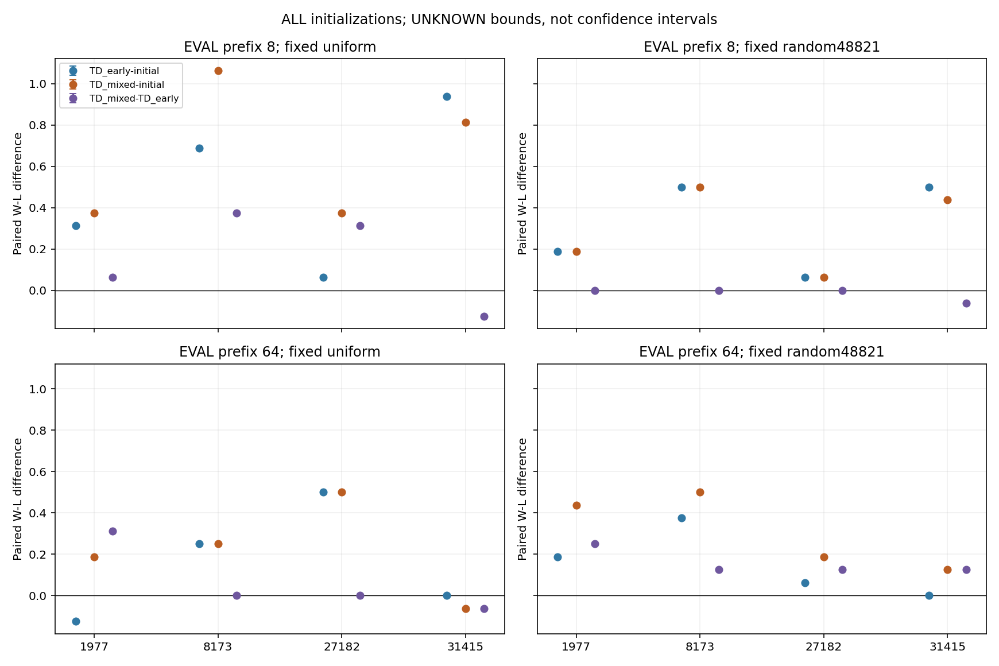
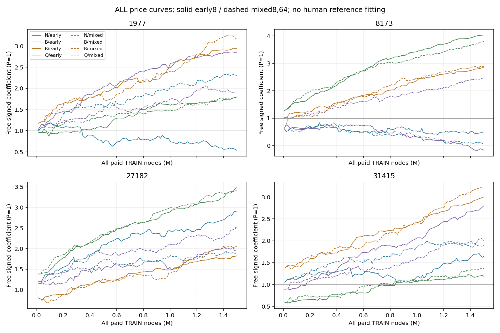
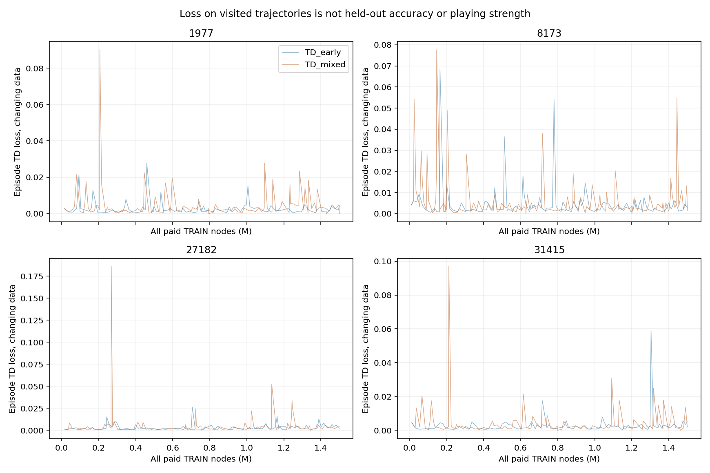
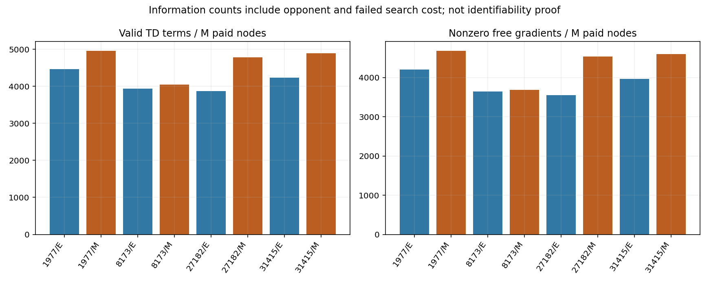

# DEV_AUX100 — TD training reset distribution

Scientific **OPEN**. Own sidemission/PUBLIC. Session 317ee713-377e-4626-8791-b890e91d8bca, actual start 2026-10-18T23:57:52.174032+00:00 unchanged; ENDED62.172min/safe_checkpoint.
Reviewed source: 6a80c3d3f07fdcb50d32e09e48931b86fab4f32d. Dot reading/execution UNCONFIRMED.

**Result:** mixed-reset TRAIN improves pooled actual W-L over early-only TRAIN by +.109375 / +.0703125 against uniform/random fixed opponents. ALL four initializations have positive pooled mixed-minus-initial gains against BOTH foes. This supports continued incremental TD learning under the declared conditions; it is not a universal improvement or converged price table.
Counterexamples retained: prefix8/random mixed-minus-early -.015625; seed31415 pooled uniform -.09375; seed31415 prefix64 mixed-minus-initial uniform -.0625. Other seed/role/family cells remain in the full summary. Mixed has13.09% more valid TD terms at equal paid TRAIN nodes; changing data/episodes prevent assigning all gain causally to term count.

**User direction:** future90-minute dev-aux heartbeat is PAUSED; current manual research/consultation continued. No automatic timer restart or other-role change.

SAME TD-Leaf candidate-turn episode learner (eta .05/lambda .95), P=1/four free finite signed coefficients, ALL four random initializations. Plain fullwidth D2 Alpha-Beta throughout, coefficient-independent path ordering, no human prices/SEE/MVV-LVA/selective pruning/prover. Parameters frozen per episode; both roles alternate against SAME fixed uniform plain opponent. UNKNOWN omits unavailable final terminal target, never draw/quantity reward. Internal theta-minimax is not an exact actual fixed-foe policy critic. Full python-chess promotion/castling/en-passant/history and common predeclared claimavailable draw rules retained.

Eight NEW TRAIN arms each1.5M ALLpaid nodes incl opponent/failed work; early8 versus scheduled8,8,64,64 prefixes, paired roles share family/prefix. Global2400s cap unchanged. Balanced EPISODES are not equal prefix node shares. Changing reset distribution changes visitation, targets, episode lengths and feedback count, not a pure feature-rank intervention. All prior caps CLOSED.

NEW common768-slot evaluation: ALL initial/early/mixed endpoint prices ×4initializations ×8underlying mechanical families ×2prefix lengths ×2roles ×2fixed plain foes; frozen ordering/querycaps/H1024/global2400s. Prefix histories8/64 share ancestors and are not independent populations. No material/root-survival/outcome filter or best seed/price/checkpoint selection. random48821 is an exposed prior opponent, not a new holdout.531kpreflight stays TRAIN-exposed.

## Actual paired price gains

W-L differences with UNKNOWN/missing bounds only, **not confidence intervals or percentage-point win-rate gains**. Allseed/role/family cells and unfavorable results remain in task2581/summary.json.

| EVAL prefix | Contrast | uniform foe | random48821 foe |
|---|---|---:|---:|
|all|TD_early-initial|[+0.328125, +0.328125]|[+0.234375, +0.234375]|
|all|TD_mixed-initial|[+0.437500, +0.437500]|[+0.304688, +0.304688]|
|all|TD_mixed-TD_early|[+0.109375, +0.109375]|[+0.070312, +0.070312]|
|8|TD_early-initial|[+0.500000, +0.500000]|[+0.312500, +0.312500]|
|8|TD_mixed-initial|[+0.656250, +0.656250]|[+0.296875, +0.296875]|
|8|TD_mixed-TD_early|[+0.156250, +0.156250]|[-0.015625, -0.015625]|
|64|TD_early-initial|[+0.156250, +0.156250]|[+0.156250, +0.156250]|
|64|TD_mixed-initial|[+0.218750, +0.218750]|[+0.312500, +0.312500]|
|64|TD_mixed-TD_early|[+0.062500, +0.062500]|[+0.156250, +0.156250]|

## Absolute terminal outcomes and headroom

| Prefix / model / foe | W / L / D / U / missing | W-L bounds |
|---|---|---:|
|8/initial/uniform|34 / 16 / 14 / 0 / 0|[+0.281250, +0.281250]|
|8/initial/random48821|44 / 4 / 16 / 0 / 0|[+0.625000, +0.625000]|
|8/TD_early/uniform|55 / 5 / 4 / 0 / 0|[+0.781250, +0.781250]|
|8/TD_early/random48821|60 / 0 / 4 / 0 / 0|[+0.937500, +0.937500]|
|8/TD_mixed/uniform|61 / 1 / 2 / 0 / 0|[+0.937500, +0.937500]|
|8/TD_mixed/random48821|59 / 0 / 5 / 0 / 0|[+0.921875, +0.921875]|
|64/initial/uniform|26 / 23 / 15 / 0 / 0|[+0.046875, +0.046875]|
|64/initial/random48821|38 / 13 / 13 / 0 / 0|[+0.390625, +0.390625]|
|64/TD_early/uniform|32 / 19 / 13 / 0 / 0|[+0.203125, +0.203125]|
|64/TD_early/random48821|45 / 10 / 9 / 0 / 0|[+0.546875, +0.546875]|
|64/TD_mixed/uniform|34 / 17 / 13 / 0 / 0|[+0.265625, +0.265625]|
|64/TD_mixed/random48821|52 / 7 / 5 / 0 / 0|[+0.703125, +0.703125]|

## ALL initialization learning curves

| Seed / TRAIN | Paid nodes | Games | Valid TD terms | Changing-data loss | N / B / R / Q |
|---|---:|---:|---:|---:|---|
|8173/TD_early|1500000|106|5914|0.00284244|0.46207669 / -0.16565109 / 2.84408221 / 4.03405645|
|31415/TD_early|1500000|90|6353|0.00192713|1.64821200 / 2.79600433 / 3.00228985 / 1.18775228|
|31415/TD_mixed|1500000|107|7340|0.0021195|1.89020695 / 2.00642182 / 3.20430625 / 1.36915552|
|1977/TD_mixed|1500000|109|7446|0.0023162|2.30510369 / 1.89006632 / 3.16276036 / 1.77576197|
|27182/TD_mixed|1500000|116|7171|0.0023217|1.87482739 / 2.50950722 / 2.03063329 / 3.40332324|
|1977/TD_early|1500000|89|6700|0.00192852|0.53495683 / 2.84573514 / 2.93983917 / 1.79993217|
|27182/TD_early|1500000|103|5811|0.00237046|2.89394459 / 1.96375189 / 1.82288001 / 3.48015435|
|8173/TD_mixed|1500000|135|6065|0.00348882|0.09186440 / 2.46648789 / 2.89138378 / 3.79973784|

| TRAIN | Unanimous coefficient pairs / 10 | Full order unanimous |
|---|---:|---|
|initial|0 / 10|False|
|TD_early|2 / 10|False|
|TD_mixed|4 / 10|False|

ALL5 coefficient ranges/RMS deviations and ALL10 pair votes are retained in task2580/stability.json. This TRAIN-only descriptive diagnostic was designed after seeing trained weights and before EVAL fitness; it does not select a pair/model or prove convergence.

Full price-order unanimity: {'TD_early': False, 'TD_mixed': False}. Negative coefficients and all exposed initialization differences retained. No human-price fitting or Xiangqi human-holdout reading.

Loss on changing TRAIN trajectories is not held-out calibration or strength. Nonzero gradients/Gram rank/credit coherence do not prove identifiability/convergence. Terminal-PV zero gradients may still credit earlier traces.

## Actual prefix mixture, feedback and cost

| Seed / method / prefix | Episodes | Paid nodes | TD terms / M nodes | Nonzero PV / M nodes |
|---|---:|---:|---:|---:|
|(8173, 'TD_early', 8)|106|1500000|3942.667|3640.667|
|(31415, 'TD_early', 8)|90|1500000|4235.333|3965.333|
|(31415, 'TD_mixed', 8)|54|895106|4145.878|3840.886|
|(31415, 'TD_mixed', 64)|53|604894|5999.398|5721.664|
|(1977, 'TD_mixed', 8)|55|921086|4363.328|4005.055|
|(1977, 'TD_mixed', 64)|54|578914|5919.705|5772.878|
|(27182, 'TD_mixed', 8)|58|889510|3957.235|3648.076|
|(27182, 'TD_mixed', 64)|58|610490|5980.442|5841.210|
|(1977, 'TD_early', 8)|89|1500000|4466.667|4204.000|
|(27182, 'TD_early', 8)|103|1500000|3874.000|3548.667|
|(8173, 'TD_mixed', 8)|68|896503|3309.526|2914.658|
|(8173, 'TD_mixed', 64)|67|603497|5133.414|4831.838|

All16 registered EVAL root descriptions were made before fitness, with no theta/search/update/filter: {'8': {'roots': 8, 'terminal': 0, 'free_phi_nonzero': 0, 'legal_action_sum': 203}, '64': {'roots': 8, 'terminal': 0, 'free_phi_nonzero': 7, 'legal_action_sum': 230}}; 0.082644s additional diagnostic/zero search nodes. These inspected roots are now exposed, not historically untouched holdouts. Current full-record overlap: {'TRAIN_records': 94, 'EVAL_records': 16, 'current_record_overlap': 0}. No claim of independent rule populations.

## Verification and boundaries

TRAIN 12000000 nodes/855 trajectories/761 actual terminals/94 UNKNOWN. EVAL 768/768 slots, 768 actual terminals/0 UNKNOWN/0 missing. UNKNOWN/missing [-1,1] sides preserved in every contrast. Actual terminal causes and paired contributions: task2581/terminal-ledger.json.
Listed new producers **23046430 paid search nodes/3017.627s**. Actual same-source16search replay: 16/16, 2292 nodes/0.269s. Independently enumerated unpruned D2 reference: 16/16, 8841 nodes/1.026s. All extra query work reported separately; audits reuse existing records and are not additional games. Producerwall includes its prefix/update/recordingI-O; extra audits/engineering/packaging/fresh/tests/transport separate. Ordinary concurrent load is a timing interpretation limit, not an automatic rerun reason.
ALL history/model/actor/foe/reset recipes, independent reverse TD sums, PV scalar/action coherence, node accounting and fixed-foe first divergences checked. First3 closed-arm prefix audit303games/39276queries/4.5Mnodes reused records only. ACTUAL fresh extraction **38 tests+12 parked then regenerated outputs**, 78.870s; exact raw hash/source-location checks, actual own stop root, no fake flags/new training/EVAL rerun. Same chess rule authority, not externalengine/all-domain proof.
Immutable45th raw capsule DELTA_REPRO_20261019_100.zip, SHA256 efaf0d34812bfef21b846b2677868fffca8510d652d454fdd6f0104f6c456109, 176 payloads/17741318 compressed bytes; previous44 unchanged. Raw large journals/executed bytepins inside ZIP are authoritative; directGit LF/EOF projection preserves AST/JSON semantics. Final report/fresh receipt/delivery metadata outside sealed ZIP.

No PRIMARY/DeepSeek checkout/state/process or product/default/UI changes; no worker/delegation/Goal/automatic integration/sandbox/master push. Their execution/adoption was not checked or claimed. Dot delivery is separate from reading/execution. Historical93D3/96missing/99 caps stay closed.

Current findings are conditional learned-price effects of the declared distributions/foes/search/budgets. They do not establish human-like ratios, stable universal prices or literal classical replication. Next executable study is selected from the ALL-seed outcome/information evidence; no winning seed or price is promoted.

## Next changed-premise study

New SelfCandidate-versus-Fixednu comparison with SAME plain TD/all4initials/mixedresets, new inputs, and within-trajectory1.25M/2.5M cost snapshots is proposed, not registered/started. Fixednu remains a competitive control. Selfplay shares coefficients across actors but retains finite-horizon/replanning mismatch; no assumption it wins.
Old96 standardChess used100k paid nodes and5-9training episodes per arm with censored WLD; it was inconclusive. Negative selfplay findings in the separate Generic panel cannot substitute for a large-dose Chess test. Prospective20MTRAIN/640commonEVAL expected75-90min including support; re-estimate before starting and consult Dot if expected>=120min. All oldcaps stay CLOSED. See task2580/alternatives-review.json and task2580/next-dose-proposal.json.
