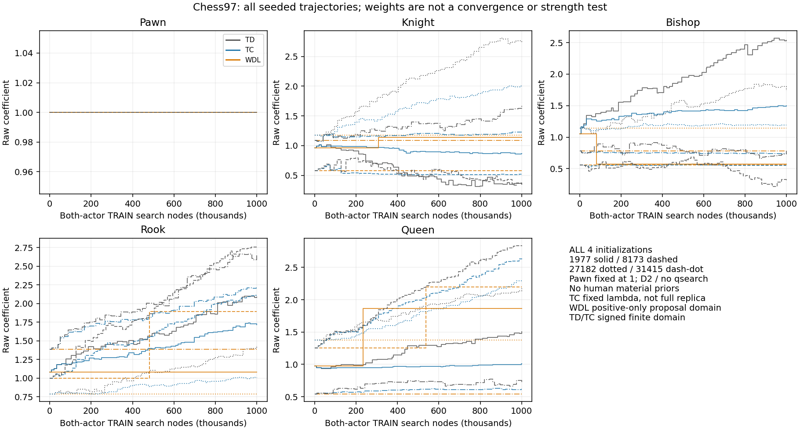
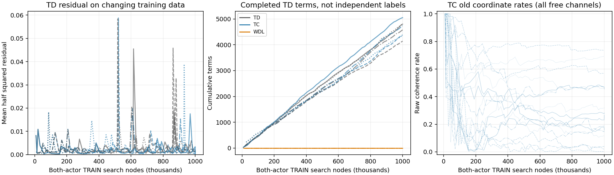
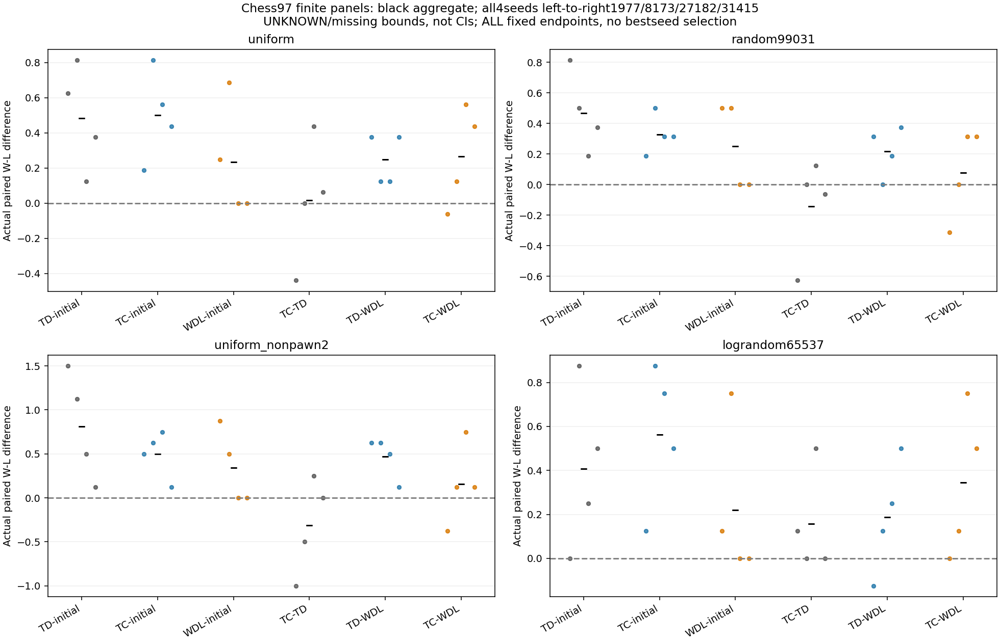

# DEV_AUX 第97段：标准Chess材料学习的实际终局正例

本轮把标准Chess训练量提高到每组100万付费搜索节点，比较TD、固定λ的Temporal Coherence（TC）及实际终局WDL候选筛选。全部四组随机初始化和所有负结果保留。原512盘验证全部真实结束；另用256槽预注册面板检查改变对手材料分布后的表现。科学状态仍为 **OPEN**。

这是一项材料学习工程实验，不是经典论文完整复现，也没有把棋价部署为产品默认值。规则、合法着、终局与完整重复历史由现有python-chess环境执行；搜索为固定D2完整Alpha-Beta，独立随机同分顺序，无人工材料先验排序、SEE、选择性裁剪或求胜器调用。

## 事前冻结的条件

- 初始化种子：1977、8173、27182、31415；兵固定为1，其余四项从Uniform(0.5,1.5)生成。没有人类价格拟合或象棋人类留出读取。
- 三种方法各4组，每组100万节点；双方、基线、候选与未完成搜索全部计费。TRAIN每盘最多25000节点、1024半回合；每次搜索最多8192节点/2秒。TD和TC只在候选方的完整搜索后取样，整盘冻结参数，再按白方坐标更新。
- 双方使用共同策略：一旦可以合法申诉三次重复或50步和棋即申诉，完整历史参与判定。其余实际将死、逼和和子力不足等由同一规则环境判定。
- TD使用η=.05、λ=.95。TC沿用同一TD目标，跨盘保存原始净更新建议与绝对建议之和，用旧一致性步长更新后再累积。固定λ与PV/tanh变换是明确变体；未使用预测衰减。参照[Beal–Smith 1999原文](https://www.ijcai.org/Proceedings/99-1/Papers/081.pdf)，不声称复现其D5/2000序列实验。
- WDL每轮比较一个预先生成的单坐标乘法候选与当前值，各下双方颜色；只有配对W−L差的下界严格大于0才接受。UNKNOWN按[-1,1]保留。WDL的正值候选域与TD/TC允许有限有符号更新的域不同，因此不是纯算法因果比较。
- 原验证：8个新机械生成起点、双方颜色、两个固定对手、全部端点与初始化，共512槽，1500秒cap。迁移验证：4个另注册起点、两个材料尺度/分布不同的合成对手，共256槽，900秒cap；在读取任何97验证胜负前注册。训练2100秒cap和旧研究cap均未延长。

## 完整规则胜负结果

下表是每局W−L收益的配对差，单元差值范围[-2,2]，**不是胜率百分点或总体置信区间**。原面板每个对手64个配对单元，迁移面板每个对手32个；不同种子与局面并非独立总体样本。UNKNOWN及缺失若存在，按预注册界保留。

| 对比 | 原：uniform | 原：random99031 | 新：uniform_nonpawn2 | 新：lograndom65537 |
|---|---:|---:|---:|---:|
| TD-initial | +0.484375 | +0.468750 | +0.812500 | +0.406250 |
| TC-initial | +0.500000 | +0.328125 | +0.500000 | +0.562500 |
| WDL-initial | +0.234375 | +0.250000 | +0.343750 | +0.218750 |
| TC-TD | +0.015625 | -0.140625 | -0.312500 | +0.156250 |
| TD-WDL | +0.250000 | +0.218750 | +0.468750 | +0.187500 |
| TC-WDL | +0.265625 | +0.078125 | +0.156250 | +0.343750 |

原512盘：512真实终局、0 UNKNOWN、0缺失，包含433次实际将死和79次规则和棋。新256槽：256真实终局、0 UNKNOWN、0缺失。原8个起点与当前训练完整初始记录重叠0；新面板重叠0。新配方不被自动当作全历史未暴露留出。

原面板中，TD对初始化在四个初值、两种颜色的汇总均为正；TC相对TD则在不同对手、初值上有正有负。必须保留负例：原random99031对手下，1977初值的TC−TD为−.625；TC−初始化在421004家族汇总为负；TD−WDL在421002和421004家族也为负。新lograndom65537对手下，1977初值TD−初始化为0、TD−WDL为−.125；新uniform_nonpawn2下，同初值TC−TD为−1。全部逐种子/颜色/家族数据见原[汇总](task2568/summary.json)及新[对手迁移汇总](task2570/summary.json)，不从中挑选权重、种子或起点。

## 实际学习量与价格轨迹

训练全部12组完成：736条轨迹、590真实终局、146 UNKNOWN，110225次查询，1200万节点，1488.492秒。TD/TC共36938次观测、36837个有效TD项及479次实际整盘权重改变；WDL共65轮比较、5轮接受，按1977/8173/27182/31415为3/2/0/0。未完成查询145次、6046节点，全部支付且不产生伪终局。

| 种子 | 方法 | P | N | B | R | Q |
|---|---|---:|---:|---:|---:|---:|
| 1977 | TD | 1.0000 | 0.3480 | 2.5353 | 2.0834 | 1.5054 |
| 1977 | TC | 1.0000 | 0.8689 | 1.5001 | 1.7135 | 1.0115 |
| 1977 | WDL | 1.0000 | 1.1395 | 0.5741 | 1.0795 | 1.8674 |
| 8173 | TD | 1.0000 | 0.3535 | 0.3020 | 2.7753 | 2.8319 |
| 8173 | TC | 1.0000 | 0.5177 | 0.5481 | 2.1103 | 2.6417 |
| 8173 | WDL | 1.0000 | 0.5806 | 0.5585 | 1.8914 | 2.1978 |
| 27182 | TD | 1.0000 | 2.7257 | 1.7319 | 1.4370 | 2.1789 |
| 27182 | TC | 1.0000 | 2.0033 | 1.1899 | 1.0053 | 2.2969 |
| 27182 | WDL | 1.0000 | 1.1748 | 1.1402 | 0.7861 | 1.3750 |
| 31415 | TD | 1.0000 | 1.6700 | 0.7794 | 2.6437 | 0.7151 |
| 31415 | TC | 1.0000 | 1.2305 | 0.7425 | 2.2118 | 0.6144 |
| 31415 | WDL | 1.0000 | 1.0900 | 0.7814 | 1.3839 | 0.5426 |

表格只作四位小数显示；精确浮点值和完整轨迹见[result.json](task2568/result.json)与原始日志，没有把显示舍入回写训练。三个方法都没有在四个初值上得到一致的完整价格排序，不能宣称稳定比例或普适棋价。

四自由通道的观测Gram在全部8个TD/TC组中均为满秩，条件数约5.18—16.87；这只反映局部特征激励，不证明外部真实价值可识别。训练损失来自随策略变化的数据，不能代替实际胜负曲线。

## 真实终局如何进入TD

36837个训练项拆分为36073个材料搜索目标、383个终局PV搜索目标、381个实际结束修正。多数最后修正的信用为0，因为搜索已先看见终局，前面的TD项已收到该信息。383个终局PV目标中382个与后续实际终局一致，1条仍是UNKNOWN；UNKNOWN没有补成胜负或和棋。零值终局PV也不被称为全防守和棋证明。

独立代数检查确认，每次实际更新等于按旧TC步长缩放后的材料搜索信用、终局PV信用及实际结束信用之和。这不是删掉某类目标再训练的反事实对局，也不是概率校准或棋力因果解释；[原始分解](task2568/credit-sources.json)保留全部通道。

## 验证与成本

三阶段生产总计26,047,558搜索节点，列出的生产墙钟合计55.211分钟；训练在迁移阶段复用且只计一次。对手/初始化/候选/失败查询均已支付，逐方法成本见汇总。工程、审计、I/O与发布另计，普通并发负载是解释限制，不据此自动补跑。

完整训练历史与逆向TD/TC累积、WDL接受区间复算通过；原与新验证的全部模型/角色/历史/PV/成本复算通过。预注册首末24个查询的独立无剪枝Minimax全部匹配，共17,916额外审计节点。相同规则执行器与有限见证不等于外部引擎或全规则证明。

第42个不可变复现包：[DELTA_REPRO_20261019_97.zip](DELTA_REPRO_20261019_97.zip)，SHA256 `48d4c06c6551f78cb6dc681cb685d4a9e7ed4ccf8a559b16961a79e81a433a7b`，17,154,015字节、174个文件；前41包哈希不变。实际新提取环境通过33项测试，并先移走12份派生输出后重建匹配，用时78.883秒。未重跑训练、验证或旧cap。原始查询全部在包内，直接Git只作LF/EOF便利投影，执行字节以包内哈希为准。

本轮普通恢复记录：本地复制式pytest没有dist-info，版本读取改用实际模块版本；初次测试有不影响测试通过的缓存权限警告，fresh禁用缓存；新图标题换行曾语法失败，原失败源保留后修正。没有因此改变生产源、参数、预算或结果，没有新增安装、Agent或产品集成。

## 结论与下一步

标准Chess已出现从随机初始化逐步更新材料系数、并在新起点上提高真实终局表现的工程正例。这个结论针对已冻结的浅层搜索、输入分布与对手；不能等同于学得人类价格、完整历史方法复现或任意GenericChess规则的稳定棋价。TC没有稳定胜过TD，当前WDL选择器的候选域也不同，相关限制保留。

下一轮优先冻结全部既有250k/500k/750k/1M训练快照，在新起点上支付实际胜负成本，画完整学习成本曲线；不用开发集挑最佳快照。随后再检验搜索路径变化和同一学习器的完整Generic规则迁移，求胜器保持可选。草案见[NEXT_STUDY](NEXT_STUDY_20261019_97.json)，尚未注册或启动。预计达到120分钟的实验仍先请Dot评估必要性。

自己的sidemission/PUBLIC；无Core、默认值、UI或其他角色写入，无自动合并。原始Slack账户输出保留在忽略本地层；本轮无新建议，Dot对97源代码的阅读/执行未确认。本研究段于2026-10-18T20:38:04.383082+00:00正常安全收尾，用时67.825分钟、7个研究检查点。源码修订d86ecdcfccb2bd268a19d7860014b2b7ff677be0已核验完整远端SHA、Public和21份匿名原始字节；Slack已发送并精确回读，阅读/执行未确认。交付记录见[DELIVERY](DELIVERY_20261019_97.json)。结束后只补齐收尾元数据。
