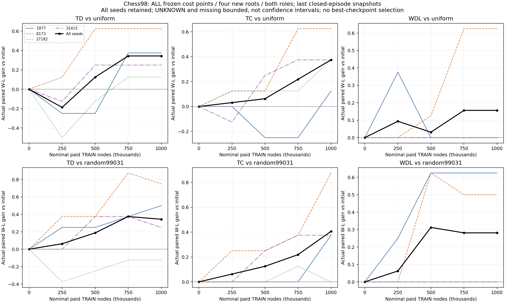
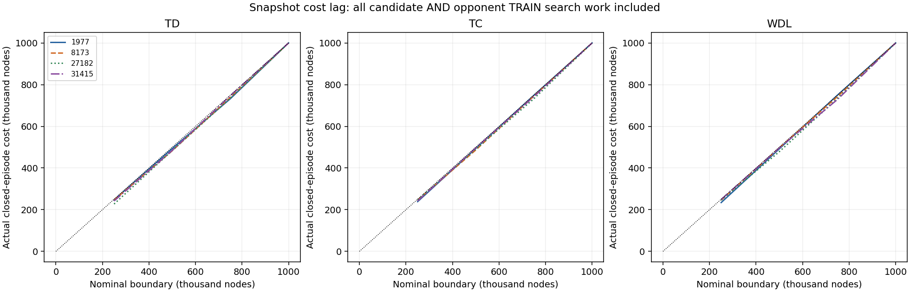
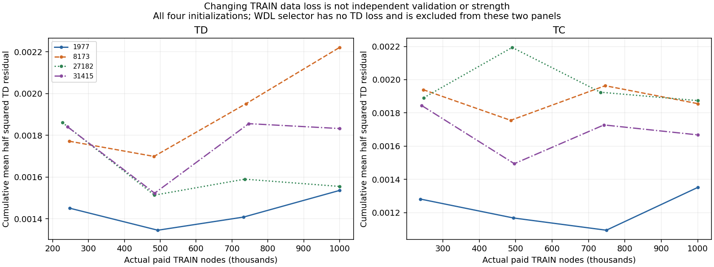
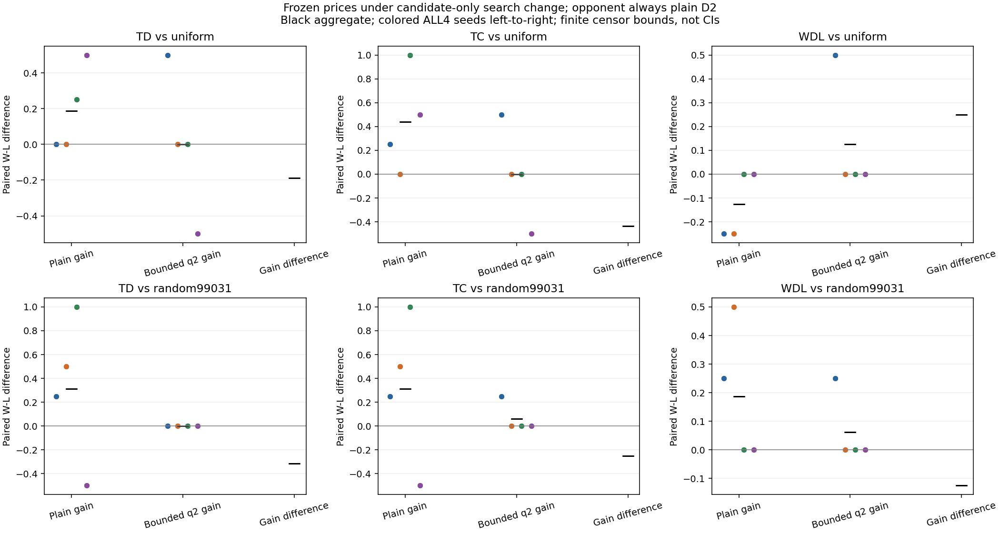
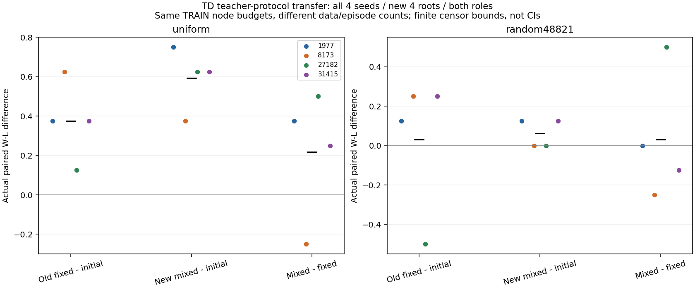

# 第98段：学习成本曲线、搜索策略交互与训练对手分布

材料学习在这些有限条件下可以改善真实胜负，但收益不随训练成本单调上升，也不能从普通D2无条件迁移到另一种搜索策略。全部种子、成本快照、负结果和部分结果保留；科学状态仍为OPEN。

本段ID `a14f40bc-61e7-4718-b55d-64f2a0dbb793`，实际开始 `2026-10-18T21:04:36.742654+00:00`，时钟未重置。官方结束 74.161分钟 / safe_checkpoint。 科学源修订：`684769bc5f78927aaf1fe741f9b153be0a6784eb`。发布与结束回执见 [DELIVERY](DELIVERY_20261019_98.json)。

第一项实验复用第97段已支付训练的全部250k/500k/750k/1M节点快照与初始模型；四个种子1977、8173、27182、31415，四个新机械起点家族441001–441004、双方角色、均一与random99031两个固定对手。832盘全部真实终局、0未知、0缺失。每个成本点每个对手32个配对单元重复使用四个起点，不是32个独立局面。中间快照取预算前最后一个已结束回合，同时报告名义与实际节点；所有48个绑定均从实际训练回合和WDL接受记录独立重建。

下表是实际W−L均值相对初始化的差，每格为均一 / random99031；范围是[-2,2]的差，不是胜率百分点或置信区间。

| 方法 | 250k | 500k | 750k | 1M |
|---|---|---|---|---|
| TD | -0.18750 / +0.06250 | +0.12500 / +0.18750 | +0.34375 / +0.37500 | +0.34375 / +0.34375 |
| TC | +0.03125 / +0.06250 | +0.06250 / +0.12500 | +0.21875 / +0.21875 | +0.37500 / +0.40625 |
| WDL | +0.09375 / +0.06250 | +0.03125 / +0.31250 | +0.15625 / +0.28125 | +0.15625 / +0.28125 |

TD对均一对手早期为负，随后转正；750k→1M为0，对随机对手最后一步为−0.03125。TC在这个起点集的汇总曲线递增，但个体种子并不单调，也未建立普遍的TC优势。TD种子27182在随机对手下1M仍为−0.125；TC种子1977在均一对手下500k/750k为负。WDL部分种子的价格保持不变，所有零更新对照保留。400组相同价格的完整棋谱、奖励、节点与查询数完全一致。没有选择最佳快照部署或重训。

训练损失来自变化中的训练轨迹，不能当成独立验证误差；它与真实胜负均不单调。首次候选行动的完整局面在每个种子/家族/角色/对手配对组内一致，64个配对组不是64个独立局面；832次首次候选查询中624次材料特征为零。原始训练目标、PV与全部胜负分别保存，不把搜索目标或棋子数量重新定义为胜负奖励。

第二项实验固定上述全部终点价格与初始化，只改变候选方部署搜索：plainD2或有界q2，两个对手始终plainD2。新家族451001–451002、双方角色、全部四种子；256盘全部真实终局，0未知/缺失/失败查询。实际q节点与对手始终无q的记录已检查，32组相同价格同策略对照完全一致。q2包含所有将军应对，但非将军节点可在有吃子时截断；它不是完整静态搜索或通用证明器。

| 价格 | plain均一 | q2均一 | plain随机 | q2随机 |
|---|---|---|---|---|
| TD | +0.18750 | +0.00000 | +0.31250 | +0.00000 |
| TC | +0.43750 | +0.00000 | +0.31250 | +0.06250 |
| WDL | -0.12500 | +0.12500 | +0.18750 | +0.06250 |

增益缩小不能简单解释为q2较差：初始化模型从plain均一10W/2L/4D变为q2的13W/1L/2D，对random99031从7W/4L/5D变为15W/0L/1D，提升空间显著改变。另一方面，TC对均一对手从plain的15W/0L/1D变为q2的14W/2L/0D，确有局部退步。TD在q2相对初始化两组均为0，但走法并不相同。两点共同限制的是价格相对完整策略的可迁移性，不能推出通用价格失败或q2总是更强/更弱。

旧第87段是q2训练价格与plain训练价格统一部署plain的比较；本段固定相同价格，只改变部署搜索，问题不同。旧负结果、旧缺失和旧cap不变。

第三项实验在前两项关闭后注册，且早于查看第二项的胜负对比：仍用相同TD学习器、.05学习率/.95衰减、同一97训练起点与走法排序配方和全部四个初始化，只将训练对手按uniform/uniform/random99031/random99031轮换。每个完整四回合循环覆盖两个教师的双方候选角色，实际尾部数量另报。原先random99031已从旧评估对手变为本次训练对手，不能再称本次留出。新评估采用471001–471004与预先指定random48821；比较全部新混合教师模型、旧97单一教师TD和初始化，192个计划槽位。训练600秒与评估600秒的上限未延长。

实际新训练 4,000,000节点 / 245回合 / 500.344秒，状态COMPLETE；评估192/192，真实终局192、未知0、缺失0，469.251秒。

| 对比 | uniform | random48821 |
|---|---|---|
| TD-initial | +0.37500 | +0.03125 |
| TD_mixed-initial | +0.59375 | +0.06250 |
| TD_mixed-TD | +0.21875 | +0.03125 |

混合教师并非逐种子占优：8173对两个对手相对旧TD均为−0.25，31415对random48821为−0.125；27182则由旧TD对该随机对手的−0.5初始化增益改善到0。汇总正差不能抹去这些反例。全部逐种子/角色/家族对比、实际教师角色数量、节点是否达到匹配预算及原始系数排序均在 [混合教师结果](task2575/summary.json)。所有新训练臂达到与旧对照一致的1M节点。 新混合教师种子8173的N系数为−0.088582，按预先允许的有符号域保留，未事后裁剪；不能称为合理稳定材料价。四种子完整价格排序一致性：旧TD=False，新混合TD=False。这仍不是唯一/通用价格或人类比例恢复的证明。

学习和搜索均保持白方坐标、线性材料特征、兵价固定1、其余四系数可为有符号有限值及tanh(material/10)。TD按候选行动间隔观察PV，参数每局冻结，真实规则终局补充最终误差；未知只省略最后终局误差，保留已完成自举转移。TC为固定lambda的原始冲量/旧一致性率变体，并非完整Beal–Smith复现。WDL的正乘法提议域与TD/TC有符号域不同，不能视为只改变优化算法的纯对照。均无人工材料权重、SEE、基于价格的排序/剪枝、通用WIN证明或残局表奖励。双方预先统一申领可用的合法三次重复/50步和棋，保留完整棋谱历史。

[TreeStrap原论文](https://papers.nips.cc/paper_files/paper/2009/file/389bc7bb1e1c2a5e7e147703232a88f6-Paper.pdf)第3–5节使用树节点与单侧搜索界损失；保留的tanh均值TreeStrap是显式变体，不应冒称论文原始线性求和版本。本段没有新TreeStrap训练或改变既有TD公式。

本段新生产搜索共27,619,004节点、列示生产墙钟3634.073秒；复用旧97训练12,000,000节点只记一次，联合工作量39,619,004节点。候选、对手、初始化、WDL旧提议/基线及失败搜索均付费；生产墙钟包含自身记录I/O；额外审计、画图、封装、传输和工程开销另列，存在重叠时不能直接相加，不把普通同机负载当作隔离CPU或速度提升。不同评估面板不合并成一个总体胜率。

实际新目录提取运行39项相关测试，并在移开旧派生文件后重建15份输出，均匹配（仅审计耗时除外），耗时80.053秒。验证使用真实本角色停止标记和新提取源路径，不复跑训练或评估。第43份不可变胶囊18,656,643字节/194个载荷，SHA256 `332b44e52852800fe75131ad188b03ef815b882258c3b4d0efcfbce948cbcc35`，前42份逐一散列不变。实际内容检查排除个人信息、密码与凭据。四份大型查询流的原始字节在胶囊内；直接Git仅做LF/EOF投影，原始字节与源固定散列以胶囊为准，见PUBLICATION_PROJECTION。相同规则库的回放/有限控制不等于独立引擎或全规则正确性证明。

发布格式检查另发现空JSONL被LF/EOF整理成空白行，已在首次推送前以独立修订修复并保留原本地提交；严格读取结果为零条，原始胶囊散列不变。投影清单不自我散列，其字节另由固定SHA与匿名读取核验，详见PUBLICATION_CORRECTION。只写本DEV_AUX独立克隆的sidemission、结果和本角色状态；未改产品默认值/UI/其他角色文件，未自动合并、创建Agent/Goal或额外收费。PRIMARY/DeepSeek没有本段新执行证据，不冒称其复验；Dot新频道根与相关完整分页线程本段未见新建议。固定源修订证据已送达Slack1792361814.382939并经完整分页回读核对，Dot阅读与执行仍未确认。Generic全规则迁移、稳定价格比例和更广分布真实棋力仍开放。
