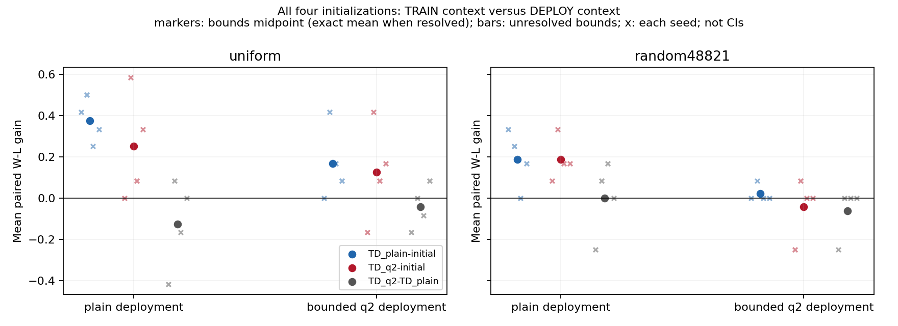
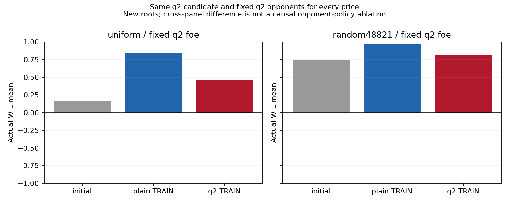
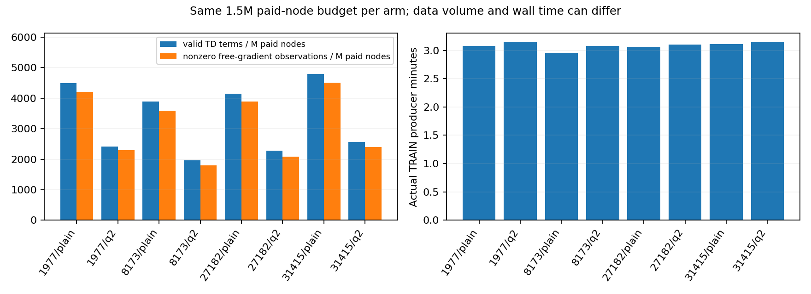
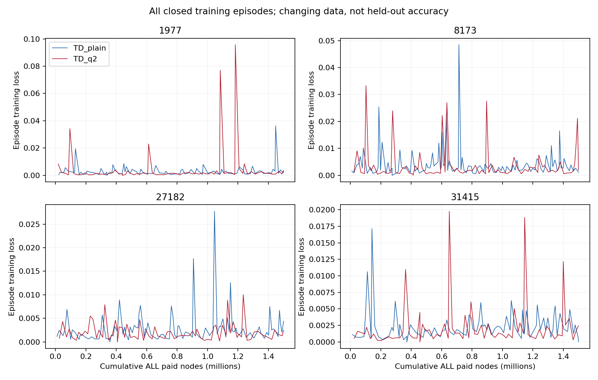

# DEV_AUX99 — matched TRAIN / DEPLOY search contexts

Scientific status **OPEN**. Own sidemission/PUBLIC. Session 9219e39a-a1b9-48b5-88ae-d4dd4d37224d, actual start 2026-10-18T22:31:24.003355+00:00 unchanged; ACTIVE;science/reproclosed, officialfinishpending.
Reviewed source: PENDING_REVIEWED_SOURCE_PUBLICATION. Dot/other-Agent reading and execution **UNCONFIRMED**.

**Result:** ordinary-search TD prices improve pooled actual W-L and have no negative seed/foe cells versus initialization in these panels. Matching q2 TRAIN to q2 DEPLOY does not outperform plain TRAIN: main q2-plain -.041667/-.0625; fixed-q2-foe panel -.375/-.15625. The latter has more baseline headroom but different roots, so no causal cross-panel opponent-policy claim. Price orders remain nonunanimous; stable/human-like/universal material values are unresolved.
q2 TRAIN has about half the valid TD terms per paid node and lower changing-data training loss in all four seeds. That loss is not target calibration or strength. This finite result motivates testing the training distribution with the cheaper SAME plain-search TD learner, not expanding q/prover coverage or declaring q2 universally useless.

SAME TD-Leaf episode learner (eta .05, lambda .95), P=1 and four unrestricted finite signed coefficients, all four random initializations, no human-price/order/SEE/pruning priors. Eight new TRAIN arms each pay1.5M BOTH-actor/failed nodes; candidate plain D2 or approximate boundedq2, fixed plain uniform opponent. Parameters stay frozen per game. Six mechanically drawn new roots, both roles, both fixed plain opponents, all initial/plain-trained/q2-trained prices deployed under both search contexts:576 scheduled games. No best seed/model/root/checkpoint selection.

Matching candidate TRAIN/DEPLOY search does not make internal theta-minimax an exact actual fixed-nu opponent critic. q2 counts all tactical plies, continues all forced evasions, may truncate noncheck captures at two plies and aborts at resource/qstack limits; not full quiescence/proof. Full standardChess promotion/castling/en-passant/history and common predeclared claimavailable draw policy preserved. UNKNOWN is not draw/quantity reward.

## Main finite price gains

Mean paired W-L differences with unresolved-outcome bounds only; **not confidence intervals or percentage-point win rates**. Fixed identical opponents/context inside each contrast. EVAL per-query caps equal, actual total cost need not match.

| Deploy | Price contrast | uniform foe | random48821 foe |
|---|---|---:|---:|
|plain|TD_plain-initial|[+0.375000, +0.375000]|[+0.187500, +0.187500]|
|plain|TD_q2-initial|[+0.250000, +0.250000]|[+0.187500, +0.187500]|
|plain|TD_q2-TD_plain|[-0.125000, -0.125000]|[+0.000000, +0.000000]|
|q2|TD_plain-initial|[+0.166667, +0.166667]|[+0.020833, +0.020833]|
|q2|TD_q2-initial|[+0.125000, +0.125000]|[-0.041667, -0.041667]|
|q2|TD_q2-TD_plain|[-0.041667, -0.041667]|[-0.062500, -0.062500]|

Matching interaction: uniform [+0.083333, +0.083333], random48821 [-0.062500, -0.062500]. This subtracts the qTRAIN-minus-plainTRAIN contrast under plain deployment from the same contrast under q2 deployment; initial cancels. All seed/role/family cells: task2577/summary.json.

## Absolute outcomes and headroom

| Model / foe | W / L / D / U / missing | W-L bounds |
|---|---|---:|
|initial|plain/uniform|27 / 10 / 11 / 0 / 0|[+0.354167, +0.354167]|
|initial|plain/random48821|35 / 3 / 10 / 0 / 0|[+0.666667, +0.666667]|
|initial|q2/uniform|40 / 2 / 6 / 0 / 0|[+0.791667, +0.791667]|
|initial|q2/random48821|47 / 0 / 1 / 0 / 0|[+0.979167, +0.979167]|
|TD_plain|plain/uniform|40 / 5 / 3 / 0 / 0|[+0.729167, +0.729167]|
|TD_plain|plain/random48821|44 / 3 / 1 / 0 / 0|[+0.854167, +0.854167]|
|TD_plain|q2/uniform|47 / 1 / 0 / 0 / 0|[+0.958333, +0.958333]|
|TD_plain|q2/random48821|48 / 0 / 0 / 0 / 0|[+1.000000, +1.000000]|
|TD_q2|plain/uniform|34 / 5 / 9 / 0 / 0|[+0.604167, +0.604167]|
|TD_q2|plain/random48821|42 / 1 / 5 / 0 / 0|[+0.854167, +0.854167]|
|TD_q2|q2/uniform|44 / 0 / 4 / 0 / 0|[+0.916667, +0.916667]|
|TD_q2|q2/random48821|45 / 0 / 3 / 0 / 0|[+0.937500, +0.937500]|

## Separately registered fixed-q2-opponent panel

Before99 main fitness inspection, a new192-slot panel froze all four initializations and all trained prices using q2 against the SAME fixed q2 opponents, new511001..4 roots/both roles/both foes. Prior98 near-maximal q2initial play versus plain foes motivates this test.1200s cap; original2400/2400s caps unchanged. Cross-panel root changes prevent a causal opponent-policy effect claim.

| Price contrast | uniform q2 foe | random48821 q2 foe |
|---|---:|---:|
|TD_plain-initial|[+0.687500, +0.687500]|[+0.218750, +0.218750]|
|TD_q2-initial|[+0.312500, +0.312500]|[+0.062500, +0.062500]|
|TD_q2-TD_plain|[-0.375000, -0.375000]|[-0.156250, -0.156250]|

## Every seed, coefficient and training loss

All seed/role/family/context/foe contrasts including unfavorable cells are retained in task2577/summary.json and task2579/summary.json. No model selected by EVAL. Equal TRAIN nodes change data/episode/TD-term counts; loss is on changing trajectories, not held-out accuracy. Nonzero gradients/Gram rank/credit coherence are diagnostics, not identifiability/convergence/strength proofs. Terminal-PV zero gradients can still credit earlier traces.

| Seed / TRAIN | Nodes | Episodes | TD terms | Nonzero gradients / M nodes | Loss | N / B / R / Q |
|---|---:|---:|---:|---:|---:|---|
|1977/TD_q2|1500000|74|3628|2290.000|0.00169909|0.05008644 / 2.97516298 / 2.54255650 / 0.77302604|
|27182/TD_plain|1500000|100|6232|3889.333|0.00193668|1.96656401 / 2.67139142 / 1.76610113 / 3.15512011|
|27182/TD_q2|1500000|76|3429|2084.000|0.00144081|1.80457079 / 3.02557161 / 1.04223678 / 2.41040778|
|8173/TD_plain|1500000|118|5844|3590.000|0.00283513|0.53831342 / 0.15779260 / 3.22288661 / 3.86584714|
|31415/TD_q2|1500000|71|3855|2401.333|0.00137193|1.92700267 / 0.86949910 / 3.01173136 / 0.40615759|
|1977/TD_plain|1500000|98|6752|4214.667|0.00197352|0.02039688 / 3.07285033 / 3.22875671 / 1.92411396|
|31415/TD_plain|1500000|88|7192|4503.333|0.0017417|2.22336555 / 0.55160495 / 3.24233445 / 1.22846136|
|8173/TD_q2|1500000|81|2946|1791.333|0.00230438|1.36972601 / 0.42183110 / 2.42247736 / 2.73640472|

Full-price-order unanimity: {'TD_plain': False, 'TD_q2': False}. Signed/negative values retained; no human-price fitting or Xiangqi human-holdout reading.

## Verification and actual cost

TRAIN 12000000 nodes/706 trajectories/532 terminals/174 UNKNOWN. MainEVAL 576/576 slots, 576 terminals/0 UNKNOWN/0 missing. Fixedq2EVAL 192/192, 192 terminals/0 UNKNOWN/0 missing.
Listed new producers: **31265336 paid search nodes / 4019.549s**. Additional actual same-source first/last TRAIN query replay 16/16 matches, 7010 nodes/1.003s. Prefix audits reuse records, not additional games. Audits/engineering/I-O/packaging/tests/transport/documentation additional. Ordinary concurrent load limits timing interpretation, not a rerun gate.
Full-history/model/role/foe/PV/cost checks and independently reconstructed reverse TD credits retained. First-query diagnostic keeps all four initial models at ONE shared full root/order, not four independent states. Its plain-PV features only excite fixedP; q2 changes action/value/free-PV features for2of4initializations. This is a target/credit mechanism example, not target correctness or strength proof. Terminal ledgers classify checkmate/threefold/50move/insufficient-material versus UNKNOWN. Current root exposure: {'current_TRAIN_records': 59, 'EVAL_records': 6, 'overlap': 0}. Mechanically new roots share starting ancestors and are not independent games/rules/populations. random48821 is an exposed prior opponent, not a newly unexposed holdout.
ACTUAL new extraction: **38 tests + 15 parked then regenerated outputs**, 62.665s, exact raw hashes/source-path checks. Same python-chess authority, not external engine/all-domain proof. Same-source search replay is not independent algorithm proof.
Immutable44th capsule DELTA_REPRO_20261019_99.zip, SHA256 fe0c116fd54548c8820e774e2268f2a14ec1b96d16e2758d5165c66a322dc6b4, 182 payloads/15853823 compressed bytes; previous43 unchanged. Exact executed bytepins/large journals are inside ZIP. DirectGit LF/EOF projection preserves AST/JSON semantics; use raw ZIP for exact pinned reproduction.

## Continuation and boundaries

Choose the next learning question from all-seed signs, actual headroom and paid information; no winning model/default changes. Same learner on complete generated Generic promotion/drops/auxiliary/history remains the target. Finite Chess effects do not establish stable universal material values or literal historical replication. Prior93 D3/96 missing/98 caps remain closed. No PRIMARY/DeepSeek checkout/state, product/default/UI or branch was written; their new execution/adoption was not checked or claimed. Dot delivery is not reading or execution.

## Preserved unfavorable cells and next executable question

Main1977 q2TRAIN-minus-plainTRAIN under plain deployment is -.416667/-.25 and under q2 deployment -.166667/-.25. Fixed-q2-foe1977 q2TRAIN-minus-initial is -.75/-.5 and q2TRAIN-minus-plainTRAIN -1.125/-.5. All other adverse/zero cells remain in full summaries; W-L differences can span[-2,2] and are not win-rate percentage points.
Fixed-q2-foe root exposure: {'full_roots': 4, 'current_TRAIN_overlaps': 0, 'main_EVAL_overlaps': 0, 'not_historically_unexposed_guarantee': True}.
New TRAIN-only reset feasibility keeps ALL16mechanicalfamilies at8/64legalplies: {'8': {'roots': 16, 'terminal': 0, 'nonzero_free_material': 0, 'free_material_feature_rank': 0, 'actual_random_plies': 128, 'distinct_full_records': 16}, '64': {'roots': 16, 'terminal': 0, 'nonzero_free_material': 14, 'free_material_feature_rank': 4, 'actual_random_plies': 1024, 'distinct_full_records': 16}}.1152actualrandomplies, zero search/learning nodes, 0.228509s additional diagnostic work. Rootfeature rank is not identifiability or a proved cause: later99TRAIN gradient Gram ranks were already4. No prices/outcomes were selected. The original observation-time field was corrected by name only, v1source/data retained. This preparation is outside the15fresh-derived-output reruns; all raw payloads are hashchecked.
Next: register early-only8 versus balanced8,8,64,64 TRAIN resets, SAMEplain TD/eta/lambda/all4initials/fixedfoe and all-paid budgets, then commonNEWactual-WLD validation including BOTHprefixfamilies/roles/foes, allinitials/priceorders/loss/cost/U. The531000..15preflight roots are TRAIN-exposed, never fresh EVAL. See task2576/next-reset-proposal.json; no next training or fitness has been started. Complete GenericSession transfer remains backup with explicit generated-distribution and non-scoring-terminal UNKNOWN handling.
